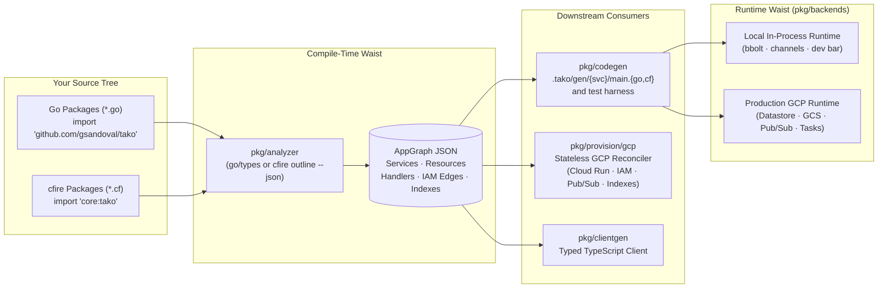
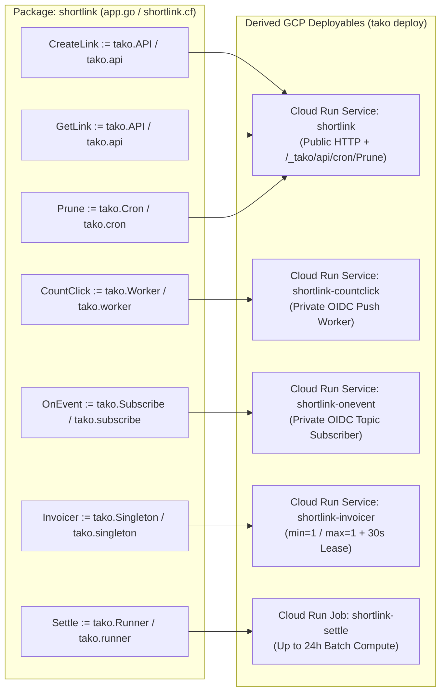
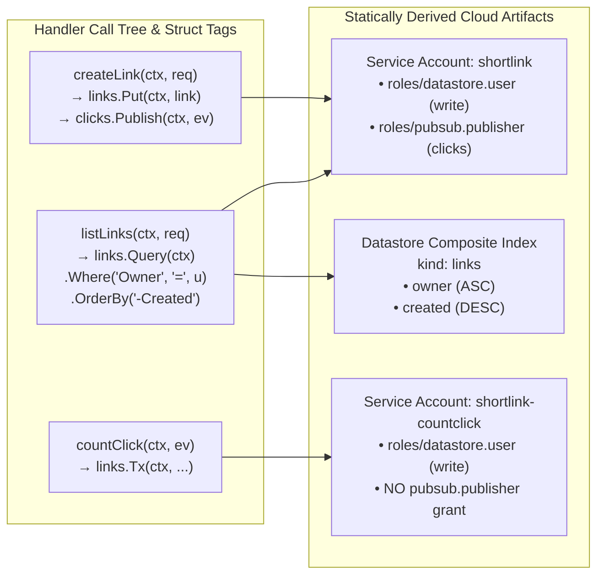

# 0 · mental model — how Tako works

Before diving into the tutorial chapters, this page lays out the core
rules that govern every Tako application — whether written in **Go**
(`.go`) or **[cfire](https://cfire.memo.engineer)** (`.cf`, lowering 1-to-1 to [ISO C++23](https://cfire.memo.engineer/guide.html#chapter-1)) — both for humans reading the architecture
and for coding agents writing handler and resource code.



## 1. Declarations are code, read statically before anything runs

Every Tako command (`tako check`, `tako dev`, `tako test`, `tako build`,
`tako deploy`) begins with the same two steps:

1. **Static analysis (`pkg/analyzer`)** reads your **Go** packages (or
   **cfire** `.cf` files via `cfire outline --json`) without executing
   them and produces the application's `AppGraph` (inspectable via
   `tako gen graph`).
2. **Code generation (`pkg/codegen`)** emits a reflection-free
   `main.go` (or `main.cf`) per deployable service under `.tako/gen/`,
   plus a per-package test harness (`tako_harness_test.go` or
   `tako_harness.cf`) mapped into `tako test`.

**Go (`app.go`):**
```go
package shortlink

import "github.com/gsandoval/tako"

var Links   = tako.Entity[Link]("links")
var Clicks  = tako.Queue[Click]("clicks")
var GetLink = tako.API("GET /links/{code}", getLink)
```

**cfire (`shortlink.cf`):**
```cfire
package shortlink

import "core:tako"

Links   := tako.entity[Link]("links")
Clicks  := tako.queue[ClickEvent]("clicks")
GetLink := tako.api("GET /links/{code}", get_link)
```

Because the analyzer reads your source tree statically:

- **Every handler and resource must be a package-level binding.** Calling
  `tako.API` / `tako.api`, `tako.Page` / `tako.page`, `tako.Worker` /
  `tako.worker`, `tako.Queue` / `tako.queue`, `tako.Entity` /
  `tako.entity`, or any other declaration constructor inside a function
  body is refused with `tako/package-level`.
- **Every handler `var` must be exported.** The generated `package main`
  under `.tako/gen/<service>/main.go` (or `main.cf`) imports your
  package from outside and registers `<pkg>.<Var>` by name.
- **Names, routes, schedules, and query fields must be string
  constants.** Routes (`tako/const-route`), resource names
  (`tako/const-name`), cron schedules, and `.Where("Field", ...)` /
  `.OrderBy("-Field")` arguments (`tako/const-query-field`) are read at
  analysis time to derive routes, cloud resource names, and composite
  Datastore indexes.
- **Configuration structs must be inline literals with constant
  fields.** Pass `tako.Route{...}`, `tako.Compute{...}`,
  `tako.CronConfig{...}`, `tako.RunnerConfig{...}`,
  `tako.SingletonConfig{...}`, `tako.SiteConfig{...}`, or
  `tako.ServiceConfig{...}` directly to the constructor, not via a
  helper function or variable (`tako/config-literal`).

## 2. Package = service, and how handlers partition

A package (Go or cfire) is the unit of service boundary, scaling
profile, and ingress posture:



| Declaration (Go / cfire) | Where it runs in `tako dev` / `tako test` | What `tako deploy` provisions in GCP |
|---|---|---|
| `tako.API` / `tako.api`, `tako.Page` / `tako.page`, `tako.Site` / `tako.site` | In the single local process | The package's **app service** (`<pkg>`, or `<pkg>-<var>` if `tako.Service` is declared) |
| `tako.Cron` / `tako.cron` | In-process ticker (`AdvanceCron` in tests) | Runs inside the package's **app service**, triggered by a Cloud Scheduler job at `/_tako/api/cron/<var>` |
| `tako.Worker` / `tako.worker` | In-process channel consumer (`DrainQueues` in tests) | Dedicated private Cloud Run **service** `<pkg>-<var>` |
| `tako.Subscribe` / `tako.subscribe` | In-process fan-out consumer (`DrainQueues` in tests) | Dedicated private Cloud Run **service** `<pkg>-<var>` |
| `tako.Singleton` / `tako.singleton` | In-process lease-guarded loop | Dedicated min=1/max=1 Cloud Run **service** `<pkg>-<var>` with a 30s distributed lease |
| `tako.Runner` (`tako.Job`) / `tako.runner` (`tako.job`) | In-process tracked task run (`DrainQueues` in tests) | Dedicated Cloud Run **Job** `<pkg>-<var>` (up to 24h timeout, parallel task sharding via `ctx.Task()`) |

**The declaring variable name is the permanent identity.** Renaming
`var MakeThumb = tako.Worker(...)` (or `MakeThumb := tako.worker(...)`)
changes the deployed service name (`gallery-makethumb`), the Cloud
Scheduler target, and the singleflight lease key. Renaming the
underlying function (`makeThumb` / `make_thumb`) changes nothing outside
your file.

Because Cloud Run enforces ingress per service, **public routes and
`tako.Route{Private: true}` routes cannot share a package**
(`tako/mixed-ingress`). Put private internal RPC endpoints in their own
subpackage (for example `billing/billing.go` in
[examples/shop](05-shop.md)) and call them from other packages via the
exported endpoint variable (`billing.Charge.Call(ctx, req)`). Calling a
handler function directly across packages is refused (`tako/raw-call`)
so the RPC boundary stays visible.

## 3. How IAM grants and composite indexes are derived

Tako has no IAM configuration files and no `index.yaml`:



- **Least-privilege IAM edges** come from scanning every handler
  function (whether written as a named function or an inline closure)
  and following same-package helper calls transitively. Touching
  `links.Get` / `Links.get` derives a `read` edge; `links.Put` /
  `Links.put` or `links.Tx` / `Links.tx` derives `write`;
  `clicks.Publish` / `Clicks.publish` derives `publish`;
  `clicks.PublishAfter` marks the queue for Cloud Tasks delayed routing;
  `auth.Users().Grant` derives an Identity Platform admin grant. Each
  deployed service gets its own service account carrying only the grants
  its reachable code paths demand.
- **Entity indexes** come from struct tags and `.Where` / `.OrderBy`
  (or `.where` / `.order_by` in cfire) call sites. Every
  `tako.Entity[T]` / `tako.entity[T]` struct must have exactly one
  string (`string` in Go, `str` in cfire) field tagged `entity:"id"`
  (`tako/entity-id`). Any field named in `.Where("Field", op, val)` or
  `.OrderBy("-Field")` must be tagged `entity:"index"`
  (`tako/unindexed-query`). Always pass the **struct field name**
  (`"Owner"`), not the `json` tag (`"owner_id"`) — Tako maps the struct
  field name to its marshaled `json` property name automatically when
  provisioning Datastore composite indexes.
- **Query fragments** — helper functions in the same package that take
  or return `*tako.EntityQuery[T]` — are followed into their callers so
  conditional filters (`if` branches) expand into every runtime query
  shape (up to 4 conditional filters per query, `tako/query-shapes`).
  Storing a query in a struct field or passing it to a function value
  is refused (`tako/query-escapes`).

## 4. Request binding & error handling matrix

Every `tako.API` / `tako.api` and `tako.Page` / `tako.page` handler
takes `(ctx: tako.Ctx, req: Req)` where `Req` is a declared struct (or
`struct{}` in Go):

**Go:**
```go
type GreetReq struct {
	Name string `path:"name"`
	Loud bool   `query:"loud"`
}

func greet(ctx tako.Ctx, req GreetReq) (Greeting, error) {
	if req.Name == "nobody" {
		return Greeting{}, tako.NotFound()
	}
	return Greeting{Message: "Hello, " + req.Name}, nil
}
```

**cfire:**
```cfire
type GreetReq struct {
    name: str  `path:"name"`
    loud: bool `query:"loud"`
}

fn greet_handler(ctx: tako.Ctx, req: GreetReq) -> Greeting! {
    if req.name == "nobody" {
        return Err(tako.not_found("not found"))
    }
    return Greeting{message: "Hello, " + req.name}
}
```

| Field shape | `GET` / `HEAD` `tako.API` / `tako.api` | `POST` / `PUT` / `PATCH` / `DELETE` `tako.API` / `tako.api` | `tako.Page` / `tako.page` (any method) |
|---|---|---|---|
| `path:"param"` | Binds `{param}` from route (`string`/`str`, `bool`, `int`/`i64`, `float64`/`f64`) | Same | Same |
| `query:"name"` | Binds URL query parameter (scalars + `[]string`) | Same | Same |
| `form:"name"` | Binds query/form value (scalars + `[]string`) | Binds form field | Binds form field (CSRF-verified on unsafe methods) |
| `tako.Blob` with `form:"file"` | Refused (`tako/blob-binding`) | Binds multipart file upload (all other fields must be tagged) | Binds multipart file upload |
| Untagged / `json:"..."` field | Refused (`tako/body-on-get`) | Decodes from JSON request body | Refused (`tako/page-binding` — pages take forms, not JSON) |

Errors returned from handlers map to HTTP statuses and retry behavior:

- `tako.NotFound()` (Go) / `Err(tako.not_found("..."))` (cfire) → **404 Not Found** (`tako.IsNotFound(err)` checks both `NotFound()` and missing entity/bucket reads).
- `tako.Errorf(status, fmt, ...)` (Go) / `Err(tako.bad_request("..."))` (cfire) → explicit **4xx/5xx** status with your message as the response body.
- `tako.Deny(msg)` → **403 Forbidden** from a `tako.Policy` (`tako.IsDenied(err)` checks it).
- `tako.Permanent(err)` → in a `Worker` or `Subscribe` handler, stops retries immediately and routes the message straight to the dead-letter queue.
- Any other error → **500 Internal Server Error** (opaque request ID returned to the client; real error logged) on HTTP routes, or a retryable failure in async handlers.

## 5. Site templates and route shadowing

When a package declares `var site = tako.Site("./web", tako.SiteConfig{})` (or `Site := tako.site("./web")` in cfire):

- Static files under `./web` (outside `templates/`) are served at `/`.
- `web/templates/layout.html` is the shared HTML shell and must contain
  `{{ block "content" . }}{{ end }}`.
- Any template file under `web/templates/` that contains
  `{{ define "content" }}` is classified as a **full page** and gets its
  own isolated clone of `layout.html` (rendered via
  `site.Render(ctx, "page.html", data)`). Templates without
  `{{ define "content" }}` are **partials** shared across all pages
  (rendered standalone for HTMX swaps via
  `site.Fragment(ctx, "card.html", data)`).
- Built-in template functions available in every template: `{{ csrf }}`,
  `{{ csrfToken }}`, `{{ markdown .Body }}`, `{{ signedIn }}`, and
  `{{ user }}`.
- **Reserved and shadowed paths:** Routes under `/_tako/` are reserved
  for framework endpoints (`tako/reserved-prefix`). If a wildcard route
  like `GET /{year}/{slug}` matches URLs where static files exist in
  `./web`, `tako check`, `tako dev`, and `tako deploy` emit a
  `tako/site-shadow` warning.

## 6. `.tako/` directory and CLI loop for humans & agents

Everything Tako generates or stores locally lives under `.tako/`
(always gitignored):

- `.tako/gen/<service>/main.go` (or `main.cf`) — the generated service
  entrypoint. Read it whenever you want to see the exact HTTP mounts and
  request decoders.
- `.tako/gen/<service>/harness/tako_harness_test.go` (or
  `tako_harness.cf`) and `.tako/gen/overlay.json` — the generated test
  harness mapped in by `tako test` so `app.Handler()` serves your
  package's real routes, auth gates, policies, and site templates.
- `.tako/lib/libtako-<os>-<arch>.a` — the cached Go C-archive runtime
  linked into native **cfire** binaries.
- `.tako/data/` — local `bbolt` entity database (`entity.db`), local
  bucket files (`buckets/`), and local dead letters (`deadletter/`).
  Delete `.tako/data/` at any time to reset local state.

Use the fast CLI loop while developing:

- `tako check` (or `tako check --json`) — runs static analysis,
  site-shadow checks, and `.tako/gen/` codegen in under a second.
- `tako test` — regenerates `.tako/gen/`, runs site builds, and invokes
  `go test -overlay=... ./...` for Go projects or `cfire test` linked
  with `libtako.a` for cfire projects.
- `tako docs list`, `tako docs <topic>`, and `tako docs search <query>`
  — read any guide chapter, reference page, or `tako docs api` directly
  in the terminal.
