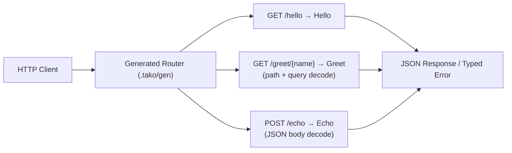

# 1 · hello — endpoints and the loop

The whole app in Go ([examples/hello](../../examples/hello/hello.go)) and `cfire` ([examples/cfire-hello](../../examples/cfire-hello/hello.cf)):

**Go**
```go
package hello

var Hello = tako.API("GET /hello", hello)
var Greet = tako.API("GET /greet/{name}", greet)
var Echo  = tako.API("POST /echo", echo)

type GreetReq struct {
    Name string `path:"name"`
    Loud bool   `query:"loud"`
}

func greet(ctx tako.Ctx, req GreetReq) (Greeting, error) {
    if req.Name == "nobody" {
        return Greeting{}, tako.NotFound()
    }
    ...
}
```

**cfire**
```cfire
package hello

import "core:tako"

Hello := tako.api("GET /hello", hello)
Greet := tako.api("GET /greet/{name}", greet)
Echo  := tako.api("POST /echo", echo)

type GreetReq struct {
    name: str  `path:"name"`
    loud: bool `query:"loud"`
}

greet(ctx: tako.Ctx, req: GreetReq) -> Greeting! {
    if req.name == "nobody" {
        return Err(tako.not_found("nobody is not here"))
    }
    ...
}
```



Everything the framework does starts from this shape:

- **A handler is a package-level var/binding** made by a constructor (`tako.API` in Go, `tako.api` in `cfire`). The declaration is the registration, the docs, and (for APIs) the callable endpoint. No comment directives, no init side effects.
- **Requests bind by tags** — `path:`, `query:` for GET; untagged or `json:`-tagged fields decode from the JSON body on writes. Binding code is *generated*, readable, and reflection-free in both Go and `cfire`.
- **Errors are values with status**: `tako.NotFound()` / `tako.not_found(...)`, `tako.Errorf(422, "message must not be empty")` / `tako.bad_request(...)` — the body is `{"error": "..."}` with that status; anything else is an opaque 500 with the real error only in your logs.

## Run it

```
# Go
cd examples/hello && tako dev

# cfire
cd examples/cfire-hello && tako dev

curl localhost:8080/hello
curl 'localhost:8080/greet/ada?loud=true'
curl -X POST localhost:8080/echo -d '{"message":"hi"}'
```

Edit a handler; the app reloads on save. The generated main under `.tako/gen/hello/` (`main.go` or `main.cf`) is meant to be read — that's the whole request path, no magic left.

The analyzer is the other half of the DX: mistakes fail at build
time with positioned, specific errors (`tako gen graph` runs just the
analysis). A non-constant route, a body on a GET, a `{param}` with no
tagged field — each has an exact message, because error text is
product surface here.

## Deploy it

```
tako setup  --project <your-project>    # once: the APIs and roles this app needs
tako deploy --project <your-project>
```

Preflight tells you anything still missing (APIs, permissions) with the
exact command to fix it — `tako setup` is what applies that list, and
[the cloud story](cloud.md) has the rest of the one-time setup; the plan
lists what will exist; the ✓ line is your URL. `tako destroy` (typed name) removes it all. That cycle —
plan, apply, converge, destroy — is the same for every example after
this one; only the graph grows.
