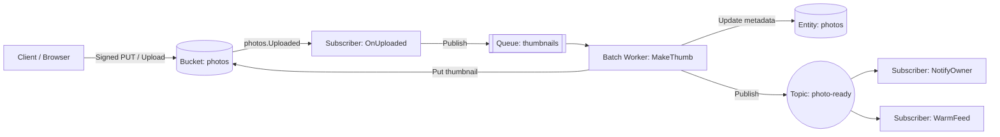

# 3 · gallery — files, events, and operations

[examples/gallery](../../examples/gallery/app.go) (Go) and [examples/cfire-gallery](../../examples/cfire-gallery/gallery.cf) (`cfire`) are the async showcase: an image pipeline that is entirely event-driven.

**Go**
```go
var photos     = tako.Bucket("photos")
var photoStore = tako.Entity[Photo]("photos")
var thumbs     = tako.Queue[ThumbJob]("thumbnails")
var ready      = tako.Topic[PhotoReady]("photo-ready")

var OnUploaded  = tako.Subscribe(photos.Uploaded, onUploaded)
var MakeThumb   = tako.Worker(thumbs, makeThumb, tako.Compute{Profile: tako.ProfileBatch})
var NotifyOwner = tako.Subscribe(ready, notifyOwner)
var WarmFeed    = tako.Subscribe(ready, warmFeed)
var Cleanup     = tako.Cron("every 24h", cleanupOrphans, tako.CronConfig{Singleflight: true})
```

**cfire**
```cfire
Photos := tako.entity[Photo]("photos")
Images := tako.bucket("gallery-images")
Uploads := tako.counter("gallery_uploads_total")

UploadPhoto   := tako.api("POST /photos/{id}", upload_photo)
GetPhoto      := tako.api("GET /photos/{id}", get_photo)
DownloadPhoto := tako.api("GET /photos/{id}/raw", download_photo)
DeletePhoto   := tako.api("DELETE /photos/{id}", delete_photo)
```



## The pipeline

upload → bucket event → queue → worker (real image resize) → topic →
two subscribers. Nobody calls anybody: **events are the preferred
inter-service style**, and each hop is a compile-checked payload.
Topic fan-out gives every subscriber its own delivery, retries, and
dead letter — one failing never delays another.

## Direct uploads (signed URLs)

`photos.SignedPut(ctx, key, 15*time.Minute, tako.PutPolicy{ContentType: "image/*", ...})`
returns a URL the browser PUTs to directly — no 32MB request cap, no
proxying. The signed upload fires the same `photos.Uploaded` event,
so the pipeline doesn't know or care how bytes arrived. Signed GETs
shape downloads the same way.

## Operations primitives

- `tako.Cache[T]` with TTL (per-instance, honestly documented),
  `GetOrFill` for cold starts, warmed by the `WarmFeed` subscriber.
- `tako.Secret("notifier-key")` resolves ONCE at startup — a missing
  secret refuses boot; `Value()` can never fail at request time.
- `tako.Counter` / `tako.Histogram` for metrics.
- `tako.Compute{Profile: tako.ProfileBatch}` on the thumb worker: its service
  gets batch scaling knobs (2 cpu, 2Gi, low concurrency).

## Coordination

`CronConfig.Singleflight` on the cron collapses overlapping runs across all
instances via a lease; `tako.Lock("reindex")` guards gallery's
cross-entity repair the same way:

```go
ran, err := relock.TryDo(ctx, rebuildFeed)  // false: already running somewhere
```

Locks are for critical SECTIONS (rebuilds, external systems) —
single-entity atomicity is `Tx`'s job. Crashes need no cleanup: the
lease TTL expires and the next campaigner takes over.

## Run it

```
cd examples/gallery
echo 'notifier-key=nk_dev_123' > .env
tako dev
# upload an image via multipart or the signed-URL flow; watch the
# pipeline narrate: event → queue → ⚙ worker → fan-out
tako test    # incl. chaos on the thumbnail path
```

Deployed, this graph becomes five services (the partition rule: sync
handlers together, each async handler its own), four dead-letter
topics, GCS notifications, and a page of derived grants — every line
of which the security summary traces back to a code edge.
