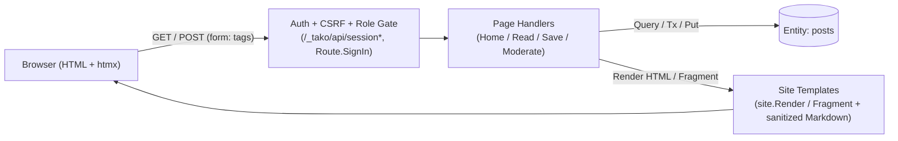

# 4 · journal — a website, no SPA required

[examples/journal](../../examples/journal/app.go) (Go) and [examples/cfire-journal](../../examples/cfire-journal/journal.cf) (`cfire`) are the server-rendered showcase: a multi-user blog in ~120 lines, with interactivity from htmx as a static asset — no client framework, no Node in production.

**Go**
```go
var posts = tako.Entity[Post]("posts")
var site  = tako.Site("./web", tako.SiteConfig{Redirects: map[string]string{"/about-us": "/about"}})
var auth  = tako.Auth(tako.AuthConfig{Google: true})

var Home    = tako.Page("GET /", home)
var Read    = tako.Page("GET /p/{id}", read)
var Save    = tako.Page("POST /p", save, tako.Route{SignIn: true})
var Publish = tako.Page("POST /p/{id}/publish", publish, tako.Route{SignIn: true})
```

**cfire**
```cfire
Posts     := tako.entity[Post]("posts")
Site      := tako.site("./web")
Auth      := tako.auth()
Moderator := tako.role("moderator")

Home     := tako.page("GET /", home)
Read     := tako.page("GET /p/{id}", read_post)
Save     := tako.page("POST /p", save_post)
Publish  := tako.page("POST /p/{id}/publish", publish_post)
Moderate := tako.page("GET /moderate", moderate)
```



## Sites and pages

`tako.Site` serves `./web` embedded in the binary — fingerprinted
assets immutable, HTML no-cache, ETags, security headers. Its
`templates/` back `site.Render(ctx, "post.html", p)` and are never
served raw. `SiteConfig.Build` runs any static generator (Hugo, esbuild…) on
the deploying machine; `SiteConfig.SPA` and `SiteConfig.DevProxy` cover the
JS-framework shapes.

Pages bind browser FORMS (`form:` tags), never JSON; CSRF on unsafe
page routes is automatic (`{{ csrf }}` in forms, a meta tag for
fetch). `tako.Redirect("/p/"+id)` is POST-redirect-GET.

Every page answers `no-cache` unless it says otherwise, because that is
the only safe default. The permalink says otherwise —
`tako.Route{MaxAge: 5 * time.Minute}` — so shared caches keep a
published post instead of revalidating it against the entity store on
every visit. Saying that on a `SignIn` route fails analysis: a shared
cache would hand one signed-in reader's page to the next.

## The pages tako writes

Some answers are not yours. A mistyped URL, a post that is gone, an
expired form, a handler that failed — tako produces those itself, and
`tako.StatusPage` is how they still look like your site:

**Go**
```go
var Status = tako.StatusPage(status)

func status(ctx tako.Ctx, s tako.Status) (tako.HTML, error) {
	return site.Render(ctx, "status.html", StatusView{
		Code: s.Code, RequestID: s.RequestID, Total: postCount(ctx),
	})
}
```

**cfire**
```cfire
Status := tako.page("GET /_status", status_page)

fn status_page(ctx: tako.Ctx, req: EmptyReq) -> str! {
    return "<main><h1>Status</h1></main>"
}
```

One page for every code — 404, 403, 405, 500 — with an ordinary `Ctx`,
so journal's 404 carries the masthead, the nav, and a live post count.
It runs at the worst moments, so it cannot make them worse: if it
panics or errors, tako answers the same plain text it always did.

`SiteConfig{NotFound: "404.html"}` is still the one-liner when a
template is all you need ([blog](06-blog.md) uses it).

## One handler, both worlds

**Go**
```go
if ctx.IsHTMX() {
    return site.Fragment(ctx, "post-card.html", p) // swap into the list
}
return tako.Redirect("/p/" + p.ID)                 // no-JS fallback: 303
```

**cfire**
```cfire
if req.header_string("HX-Request") == "true" {
    return "<article class=\"post-card\">" + p.title + "</article>"
}
return "<meta http-equiv=\"refresh\" content=\"0;url=/posts/" + p.slug + "\">"
```

`Fragment` renders without the layout; `Redirect` automatically emits
`HX-Redirect` under htmx. Progressive enhancement is one visible
branch.

## Markdown, sanitized by default

`{{ markdown .Body }}` renders authored content with goldmark, then
STRIPS scripts and handlers (bluemonday) — an XSS payload vanishes,
not escapes. Trusting raw HTML is an explicit, graph-visible opt-out
(`tako.SiteConfig{TrustedHTML: true}`), never a default.

## Auth and sessions

`tako.Auth(tako.AuthConfig{Google: true})` is one declaration: `/_tako/api/session*`
routes mount, a framework sign-in page appears, `Route.SignIn` gates
routes with a 401, `ctx.User()` is guaranteed past it, and ownership
stays YOUR rule (`403 only the author can publish`). Sessions are
**revocable records in the entity store** — delete one in the console
and that browser is signed out on its next request. Locally the dev
bar signs in test users; in the cloud it's real Identity Platform
(the one manual step: [the Google provider toggle](cloud.md)).

## The door: one policy, two routes

Ownership answers "may this user touch THIS post". The moderation desk
asks a different question — "who may see everyone else's drafts" — and
that one belongs to the route:

**Go**
```go
var Moderator  = tako.Role("moderator")
var Moderators = tako.RequireRole(Moderator)

Moderate = tako.Page("GET /moderate", moderate, tako.Route{Allow: Moderators})
Retract  = tako.Page("POST /moderate/{id}/retract", retract, tako.Route{Allow: Moderators})
```

**cfire**
```cfire
Moderator := tako.role("moderator")

Moderate := tako.page("GET /moderate", moderate_page)
Retract  := tako.page("POST /moderate/{id}/retract", retract_post)
```

`retract` then contains no authorization at all — the door is the
declaration, and the handler is about the act. For a rule roles cannot
express, `tako.Policy(fn)` takes a body: return `nil` to admit,
`tako.Deny(msg)` to refuse, and any other error to say it could not
decide, which answers 500 rather than handing a visitor an internal
message.

Locally the role is a checkbox on `/_tako/signin` — there is no Identity
Platform on a laptop to hold a claim, and ticking it is deliberate so
you can also sign in WITHOUT it and see the refusal.

Two things follow that are easy to miss. `tako gen graph` now prints
`GET /moderate → Moderate 🔒 Moderators`, so "which routes can a
stranger reach" is a question the graph answers. And the status page
branches on `Status.Policy`, because 403 was CSRF's answer here until
this journal had a door — without it, a reader who is not a moderator
would be told their form expired. Details in
[reference/auth.md](../reference/auth.md).

## Run it

```
cd examples/journal
PORT=8090 tako dev     # open localhost:8090, sign in via the dev bar
tako test              # 401s/403s, CSRF, fragments, sanitization — as user-style tests
```
