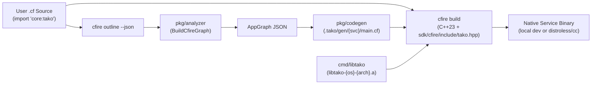

# 7 · cfire — native C++23 systems apps on Tako

Tako's architecture sits on two narrow waists: a compile-time `AppGraph` JSON contract and a runtime backend interface over opaque bytes. Because neither waist depends on Go's runtime inside your business logic, **[cfire](https://cfire.memo.engineer)** (`.cf`) applications — which lower 1-to-1 to modern **[ISO C++23](https://cfire.memo.engineer/guide.html#chapter-1)** ([GitHub](https://github.com/gsandoval/cfire)) — are first-class citizens in Tako alongside Go.

Three canonical `.cf` examples mirror the Go progression, and all seven examples have `.cf` counterparts:
- [examples/cfire-hello](../../examples/cfire-hello/hello.cf) — endpoints, path/query/JSON binding, and typed errors.
- [examples/cfire-shortlink](../../examples/cfire-shortlink/shortlink.cf) — entities, indexed fields, queues, workers, caches, and cron schedules.
- [examples/cfire-gallery](../../examples/cfire-gallery/gallery.cf) — object storage buckets, entities, and custom metrics.
- [examples/cfire-journal](../../examples/cfire-journal/journal.cf) — server-rendered HTML pages, forms, auth, and roles.
- [examples/cfire-shop](../../examples/cfire-shop/shop.cf) — catalog/order entities, batch jobs, runners, and singletons.
- [examples/cfire-blog](../../examples/cfire-blog/blog.cf) — static site with dynamic htmx comment fragments.
- [examples/cfire-siren](../../examples/cfire-siren/siren.cf) — counters, histograms, and alert metrics.

**Go**
```go
package shortlink

import "github.com/gsandoval/tako"

var (
    links   = tako.Entity[Link]("links")
    clicks  = tako.Queue[ClickEvent]("clicks")
    hotURLs = tako.Cache[string]("hot-urls", 5*time.Minute)

    GetLink      = tako.API("GET /links/{code}", getLink)
    ProcessClick = tako.Worker(clicks, processClick)
    PruneExpired = tako.Cron("0 * * * *", pruneExpired)
)
```

**cfire**
```cfire
package shortlink

import "core:tako"

type Link struct {
    code:       str `entity:"id" json:"code"`
    url:        str `json:"url"`
    owner_id:   str `entity:"index" json:"owner_id"`
    clicks:     i64 `entity:"index" json:"clicks"`
    created_at: i64 `entity:"index" json:"created_at"`
}

type GetLinkReq struct {
    code: str `path:"code"`
}

type ClickEvent struct {
    code:    str `json:"code"`
    ts_unix: i64 `json:"ts_unix"`
}

Links   := tako.entity[Link]("links")
Clicks  := tako.queue[ClickEvent]("clicks")
HotUrls := tako.cache[str]("hot-urls")

GetLink      := tako.api("GET /links/{code}", get_link)
ProcessClick := tako.worker(Clicks, process_click)
PruneExpired := tako.cron("0 * * * *", prune_expired)
```

## Same six rules, native systems performance

Because `cfire` lowers [1-to-1 into standard ISO C++23](https://cfire.memo.engineer/guide.html#12-predictable-11-lowering-table) with zero garbage collection inside your handler logic, deterministic RAII memory management, [explicit call-site mutation & move safety](https://cfire.memo.engineer/guide.html#chapter-4), and direct C/C++ header ingestion ([Systems Landscape](https://cfire.memo.engineer/#landscape) · [Performance & Comparison Matrix](https://cfire.memo.engineer/#benchmarks)), you can write latency-critical compute, SIMD JSON pipelines, and native C/C++ library integrations using the [28 built-in `core:*` modules](https://cfire.memo.engineer/reference.html) while obeying the exact same structural rules as a Go Tako application:

- **Top-level declarations:** Resources (`tako.entity`, `tako.queue`, `tako.bucket`, `tako.cache`, `tako.counter`) and handlers (`tako.api`, `tako.worker`, `tako.cron`, `tako.subscribe`) are package-level bindings.
- **Compile-time constant names:** Resource names, route patterns, and cron schedules must be string literals (`tako/const-name`).
- **Struct tags drive binding and indexing:** Request structs bind via [compile-time struct tags](https://cfire.memo.engineer/guide.html#chapter-5) `path:"..."`, `query:"..."`, `header:"..."`, and `json:"..."` (`tako/route-params`). Entity structs require a single `str` field tagged `entity:"id"` (`tako/entity-id`) and mark filterable fields with `entity:"index"`.
- **Result & error ergonomics:** Handlers return [value-based fallible results `Res!`](https://cfire.memo.engineer/guide.html#chapter-6) (`std::expected<Res, cfire::Error>`) and propagate errors with `try` or return status-coded errors via `Err(tako.not_found("..."))` and `Err(tako.bad_request("..."))`.

## How the bridge works



1. **Static analysis (`tako gen graph`):** When Tako detects `.cf` files in a directory without a `go.mod`, it invokes `cfire outline --json` to inspect packages, struct field tags, global resource declarations, and handler signatures, producing the standard `AppGraph`.
2. **Readable generated code (`.tako/gen/<service>/main.cf`):** Codegen emits a human-readable `main.cf` per service that registers entity schemas, decodes HTTP path/query/JSON parameters, and mounts handlers.
3. **The `libtako` C-archive runtime (`cmd/libtako`):** Tako compiles its local (`bbolt`) and cloud (Datastore, GCS, Pub/Sub, Cloud Tasks, Secret Manager) backends into a static C archive (`.tako/lib/libtako-<os>-<arch>.a`) and links it with the C++23 output of `cfire build` using the headers in [sdk/cfire/include/tako.hpp](../../sdk/cfire/include/tako.hpp).

## Run and inspect it

```
cd examples/cfire-shortlink
tako gen graph
tako gen graph --mermaid
tako dev
```

Edit any `.cf` file and save; `tako dev` re-runs the analyzer, regenerates `.tako/gen/<service>/main.cf`, links against the cached `libtako.a`, and hot-reloads the native binary.

## Deploy it

```
tako deploy --project <your-project>
```

For `.cf` services, `tako build` and `tako deploy` cross-compile a `linux/amd64` binary linked against `libtako-linux-amd64.a` and layer it onto `gcr.io/distroless/cc-debian12:nonroot` (providing `glibc` and `libstdc++` with no shell or package manager). See [cfire.md](../reference/cfire.md) for the complete SDK reference.
