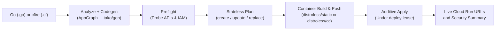

# The cloud story

`tako deploy` reconciles your code onto GCP with no state file: it
reads the live project, labels everything it creates, and converges.

## What one deploy does

```
analyzing → site builds → codegen → preflight → plan → build/push → apply → URLs
```



- **Preflight** probes exactly the APIs and permissions your graph
  needs and prints copy-pasteable remediation when something is
  missing (enable command, grant command, or console step).
- **The plan** classifies every change before touching anything:
  `+ create`, `~ update` (in place), `! replace` (delete+recreate —
  prompts), `? orphaned (kept)` (left your code — never auto-deleted),
  and DRIFT warnings for things edited outside tako.
- **Apply** is additive-first, under a deploy lease, so two deploys
  can't interleave and old+new revisions stay correct mid-rollout.

## What gets created, and who may do what

Package = service. Each service runs as its OWN service account, and
every IAM grant is DERIVED from your code: the analyzer sees which
handlers touch which resources (and which services call which), and
grants exactly those edges — bucket access per bucket, publisher per
topic, `run.invoker` per callee, lease access when you use locks. The
deploy ends with a security summary tracing every grant to the code
that demanded it, plus warnings for anything internet-open.

Removing code removes its grants on the next deploy: revocation is
convergence, not cleanup you remember to do.

### The first two minutes after a deploy

A fresh deploy can log a short burst of 403s on the endpoints tako
calls with an OIDC token — the push endpoints Pub/Sub delivers to, and
the `/_tako/api/cron/*` route Cloud Scheduler triggers — looking like this:

```
POST /_tako/api/push → 403
The request was not authenticated. … The IAM principal lacks {run.routes.invoke} permission.
```

**This is expected and self-healing.** Tako grants the calling identity
`roles/run.invoker` on its service and creates the caller after — the
reconcile order is grants, then push subscriptions and scheduler jobs —
but IAM changes take up to a couple of minutes to propagate through
Cloud Run's front door. Pub/Sub retries with backoff, so messages arrive
once the grant lands, and at-least-once delivery means nothing is lost.
A cron that fires inside the window is skipped rather than queued: the
next scheduled run is the recovery, so trigger it by hand if you cannot
wait. Tako already treats this class of lag as normal elsewhere — boot
retries Secret Manager reads for 90 seconds for the same reason.

It is worth a look only if it does NOT stop. Confirm delivery recovered:

```
# a 204 on the same endpoint, after the 403s
gcloud logging read \
  'resource.labels.service_name="<env>-<app>-<subscriber>" AND httpRequest.status=204' \
  --project <project> --limit 3 --freshness 15m

# and nothing gave up into the dead-letter queue
tako dlq <app>-<subscriber> --project <project> --env <env>
```

Dead letters with that 403 as their reason mean the grant never landed,
which is a tako bug — re-run `tako deploy` and file it if it persists.

## The confirmation ladder

Friction scales with irreversibility (also in `tako --help`):

1. Reversible/derivable — no ceremony (promote/rollback; pruning
   orphaned compute).
2. Risky but recoverable — deploy prompts y/N on replaces and rename
   suspects; `--yes` pre-answers that prompt for CI, and nothing else.
3. Data, gone forever — typed confirmations (`destroy`,
   `prune --data`), never bypassable.

## One-time project setup

Two commands come before your first deploy, and both are once per
project:

```
tako setup                              enable the APIs and grant the roles this app needs
tako datastore create --region us-central1   only if the app declares a tako.Entity
```

`tako setup` is the applying half of preflight: it reads your graph and
enables exactly the APIs and grants exactly the permission→role pairs
*that* graph needs, so an app with no queues asks for nothing about
Pub/Sub. It is idempotent — re-run it when the app grows a resource —
and `--member` points it at a CI service account instead of you. If you
cannot grant yet, it prints the `gcloud` command for whoever owns the
project: granting yourself the permission to grant is the one step
nobody can bootstrap.

`tako datastore create` is separate from everything else because its
choice cannot be undone — a database's location is permanent, so
`--region` is required and never defaulted. `destroy` leaves the
database behind for the same reason.

The rest is automated: APIs probed by preflight, Identity Platform
initialized, the email provider enabled when declared, sign-in
domains registered per deploy.

**A genuinely manual step** — only when your app declares
`tako.AuthConfig{Google: true}` — is enabling the Google provider, because Google
has no public API for creating external OAuth clients:

> Firebase console → your project → Authentication → Sign-in method →
> Google → Enable (pick a support email) → Save.

That single toggle auto-provisions the OAuth client. The deploy
BLOCKS with this exact instruction (and a hand-built GCP-console
alternative for org-restricted accounts) until it's done, and rejects
placeholder client IDs before your users ever see `invalid_client`.
Secrets are the other human input: `tako.Secret("name")` must exist
in Secret Manager; preflight prints the exact command.

**Custom domains add two more**, and only when you declare
`tako.ServiceConfig{Domain: ...}` — both because they are yours to prove and yours
to publish, not tako's to fake:

1. **Ownership**, once per project. Preflight refuses until it's done:
   `gcloud domains verify example.com` (it opens Search Console).
   Verifying the parent covers its subdomains.
2. **DNS.** The deploy prints the exact records, relative to your zone
   the way a registrar's host field wants them, then tells you to re-run.
   Certificates issue once the records resolve — usually ~15 minutes,
   occasionally up to 24 hours. Deploys are stateless and resumable, so
   re-running just reports where the certificate got to; nothing is lost
   by checking, and no state is kept between runs.

A domain mapping ADDS an address — the `run.app` URL keeps working, and
the security summary says so plainly. What tako deliberately does NOT
provision here (a load balancer, edge CDN), what it would cost, and what
would make tako change mechanisms are all in
[domain-options.md](../domain-options.md).

## Reaching a deployed app from a tool

A backfill, an importer, an operator script — anything that has to write
into a deployed store — is not run by `tako dev`, is not a generated
service, and must not be a test app. It boots the cloud backends itself
and then uses the same handles the service does:

```go
func main() {
	project := flag.String("project", "", "GCP project")
	env := flag.String("env", "", "prod, or a preview env")
	flag.Parse()

	if err := runtime.BootGCPWith(gcp.Options{
		Project: *project, App: "flauta", Env: *env,
	}); err != nil {
		log.Fatal(err)
	}

	// posts, photos, thumbs — the declarations, unchanged
	if err := posts.Put(ctx, p.Slug, p); err != nil {
		log.Fatal(err)
	}
}
```

`runtime.BootGCPWith` takes the target as an **argument**, because the
target of a command-line run is an argument and not an ambient fact. The
alternative is a program setting `TAKO_PROJECT` in its own environment to
configure a library, which works and is a shape worth not spreading.

**`Env` is required and never defaulted.** It is the Datastore namespace
and the prefix on every derived name, so a tool that addressed prod
because a flag was empty is precisely the accident this signature
prevents:

```
tako: BootGCPWith needs Options.Env — project, app and env together name the
resources a deployed service reads, and env is the Datastore namespace, so it
is required rather than assumed to be prod
```

`Project` and `App` are required for the same reason; `Service` is
optional and only shapes dead-letter topic names, which a tool that
publishes nothing never reaches. The tool authenticates as you do —
whatever `gcloud auth application-default login` left behind — so it can
reach exactly what your own account can.

A generated service still calls `runtime.BootGCP()`, which reads the
environment the deploy injects. Both boot the same backends; they differ
only in where the target comes from.

## What destroy deletes — and deliberately leaves

`tako destroy` (typed app name) deletes everything it created for the
app, data included, and unregisters its sign-in domains. It
deliberately leaves project-level, shared, or human-owned things:
Identity Platform initialization, providers and their OAuth client,
user accounts, Secret Manager secrets, enabled APIs, the Datastore
database, and the browser API key. Preview environments
(`--env pr-42`) destroy only their own slice and never shared
machinery.

Custom domains follow the same line. Destroy removes the domain MAPPING
— first of all, before the service it points at stops existing — but
never touches your **DNS records** or your **domain verification**: both
live at your registrar and in your Google account, not in the project
tako manages. A mapping that never resolved still deletes cleanly, so an
abandoned domain leaves nothing behind on the cloud side; the dangling
record at your registrar is yours to remove.
