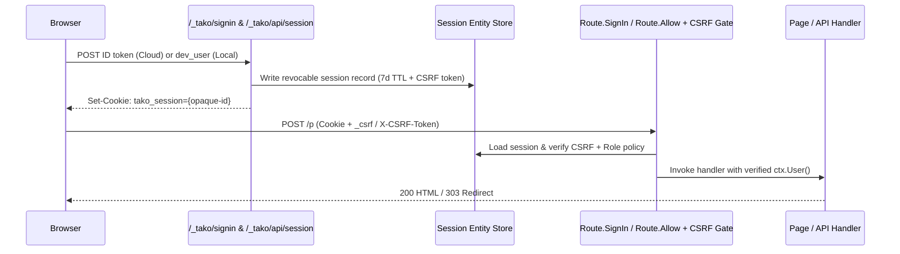

# tako.Auth — providers, sessions, Route.SignIn, the dev bar

## Declare

**Go** ([examples/journal](../../examples/journal/app.go), [examples/shop](../../examples/shop/app.go))
```go
auth = tako.Auth(tako.AuthConfig{Google: true})   // journal: Google sign-in
auth = tako.Auth(tako.AuthConfig{Password: true})    // shop: email/password
```

**cfire** ([examples/cfire-journal](../../examples/cfire-journal/journal.cf))
```cfire
Auth      := tako.auth()
Moderator := tako.role("moderator")
```



One declaration injects the session surface: `POST /_tako/api/session`
(exchange a sign-in for a session), `DELETE /_tako/api/session` (sign out),
`GET /_tako/signin` (the framework-owned sign-in page — your app just
links to `/_tako/signin` or `/_tako/signin?next=/path` to return the
visitor where they started), and the form-friendly `POST
/_tako/api/session/signout`.

Sessions are **revocable entity records**: the cookie carries only an
opaque random id; the record holds the identity and the session-bound
CSRF token. Sign-out (or an operator, in the console) deletes the
record and the session is dead on the next request — revocation is
real, not a cookie waiting to expire. Sessions last 7 days.

**The declaration is a restriction.** A session may only come from a
provider you declared: `AuthConfig{Google: true}` refuses a token
minted by email/password, whatever else the Identity Platform project
has enabled.

That matters because a project's providers are not only yours. Identity
Platform enables them per project, and a deploy of another app, a
console click, or a default can turn on email/password with
self-service sign-up. Before tako checked, an app declaring
`Google: true` accepted any token the project would issue — so a
self-registered password account produced a session, and the only thing
between it and an admin was whatever the app compared next.

The refusal names both halves:

```
the ID token did not verify: this token was minted by email, and this app declares google — tako.AuthConfig decides which doors exist
```

It is checked at **sign-in**, so sessions already established keep
working until they expire or are revoked. Changing what you declare
never signs anyone out mid-visit.

## Use

`tako.User` carries `ID`, `Email`, `Name`, and two claims about how the
user got here:

| field | |
|---|---|
| `Provider` | which declared provider minted this session: `"google"`, `"email"` |
| `EmailVerified` | the provider's claim about the address |

`EmailVerified` is worth a moment if you authorize **by email** — an
editor allowlist, say. That check is only as strong as the guarantee
that the address belongs to whoever signed in. Google guarantees it.
Email/password guarantees whatever the project was configured to
require, which your app cannot see, so the claim is handed to you
rather than assumed:

```go
if !ctx.User().EmailVerified {
	return tako.HTML{}, tako.Errorf(403, "this address is not verified")
}
```

`Route{SignIn: true}` gates a route with a 401; past it, `ctx.User()` is
guaranteed. On public routes use `ctx.MaybeUser()` — calling `User()`
on an unauthenticated request panics. From
[examples/journal](../../examples/journal/app.go):

```go
Save    = tako.Page("POST /p", save, tako.Route{SignIn: true})
Publish = tako.Page("POST /p/{id}/publish", publish, tako.Route{SignIn: true})
```

```go
p := Post{ID: tako.NewID(), Owner: ctx.User().ID, Title: req.Title, ...}
```

Ownership is the handler's own rule, not the framework's: journal's
publish checks `current.Owner != ctx.User().ID` and returns a 403.
[Shop](../../examples/shop/app.go)'s public `/api/me` probe shows
`if u, ok := ctx.MaybeUser(); ok { ... }`.

Sessions cross service calls automatically: an `Endpoint.Call` carries
the caller's session id in `X-Tako-Session`, and the callee's record
lookup IS the verification — revocation kills the identity mid-chain.
See [calls.md](calls.md).

## Authorize: tako.Policy and Route.Allow

Authentication says somebody signed in. **Which** of the people who
signed in may use a route is a policy — declared, like everything else:

```go
var Moderators = tako.Policy(moderator)

func moderator(ctx tako.Ctx, u tako.User) error {
	for _, m := range moderators {
		if u.Email == m {
			return nil
		}
	}
	return tako.Deny("the moderation desk is limited to this journal's moderators")
}
```

```go
Moderate = tako.Page("GET /moderate", moderate, tako.Route{Allow: Moderators})
Retract  = tako.Page("POST /moderate/{id}/retract", retract, tako.Route{Allow: Moderators})
```

One policy serves as many routes as share the door, and the handlers
open with their own work rather than with four lines of preamble. It is
worth saying what that preamble cost, since it is the reason this
exists: an app carrying an admin wrote the same check at **49 call
sites in 12 files**, and no tool could answer "which of my routes can a
stranger reach" because the answer lived in function bodies.

| | |
|---|---|
| return `nil` | admit |
| return `tako.Deny(msg)` | refuse: 403, `msg` shown to the visitor |
| return any other error | **could not decide**: 500, logged under the request id, never rendered |

That third row is the guard. A store read that failed while deciding is
not a decision, so the only text that reaches a visitor is text you
wrote deliberately.

**`Allow` implies `SignIn`.** A policy takes a `User`, so the 401 gate
is in front of it and `ctx.User()` is guaranteed past it. Writing both
is redundant, not wrong.

**It sees the user, not the request.** A policy answers *who may reach
this route*. Whether this user may touch *that record* is a question
about the record, and it belongs in the handler that loaded it —
journal's `publish` still checks `current.Owner != ctx.User().ID`.
Keeping the two apart is what lets one policy serve fifty routes.

**Enforced by `Endpoint.Call`, not by the mount.** That is one
enforcement point for a browser request, an in-package call, a test,
and a cross-service call — the last being the one place a trust
boundary is actually crossed. A remote hop is the exception and
deliberately so: the callee evaluates its own policy, because the rule
may read the callee's entity store. Callers can test the verdict with
`tako.IsDenied(err)`.

### Roles

A role is a NAME an identity carries into the request, and the only
thing tako knows about it. Declare it, then put a door behind it:

```go
var Moderator  = tako.Role("moderator")
var Moderators = tako.RequireRole(Moderator)          // any-of, if you pass several

var Moderate = tako.Page("GET /moderate", moderate, tako.Route{Allow: Moderators})
```

`RequireRole` returns an ordinary policy, so it goes exactly where a
hand-written one goes and is enforced at the same point. A rule that
needs two roles at once, or a role plus something else, is a
`tako.Policy` with a body — this is the shorthand, not the ceiling.

Elsewhere, ask the user:

```go
if ctx.User().HasRole(Moderator) { … }   // for the one extra button
```

The refusal names the role, because a role name is not a secret and
"not authorized" sends somebody to ask a question nobody can answer:

```
this page needs the moderator role
```

**Where roles live.** In the cloud, an Identity Platform **custom
claim** — so they arrive in the ID token and tako reads them at sign-in.
On a laptop there is no Identity Platform, so they live on the local
user record and `tako dev`'s sign-in page offers a checkbox per declared
role. Ticking is deliberate: a local session that carried every role
would make the refusal path — the half of authorization worth walking —
unreachable in dev.

**Live session refresh on role changes.** `tako.User.Roles` is cached
on the session record, and granting or revoking a role through
`auth.Users()` (or `tako users grant` / `revoke`) marks that user's live
sessions stale so their very next request refreshes the roles from the
store without signing them out.

The name must be a string constant and the var must be exported — it is
read at analysis time, so `tako gen graph` can print it beside the door:

```
GET /moderate → Moderate 🔒 Moderators (moderator) (app.go:189)
```

### Accounts: auth.Users()

Creating accounts and handing out roles, from Go:

```go
users := auth.Users()

u, err := users.Create(ctx, tako.NewUser{
	Email: "ana@example.com", Name: "Ana", Password: pw,   // Password is optional
})
err = users.Grant(ctx, u.ID, Moderator)
err = users.Revoke(ctx, u.ID, Moderator)
err = users.Disable(ctx, u.ID)   // sign-in refused, record kept, sessions ended
err = users.Enable(ctx, u.ID)
err = users.Delete(ctx, u.ID)

u, err = users.ByEmail(ctx, "ana@example.com")
page, err := users.List(ctx).Limit(50).Page("")   // page.Next is the cursor
```

| | |
|---|---|
| cloud | Identity Platform accounts; roles are a custom claim |
| local | the same contract over the local store, in the same bbolt file `tako dev` already keeps |

### The same thing, from a terminal: `tako users`

An operator should not have to write, deploy and delete a program to
make the first admin. `tako users` is a door onto exactly the surface
above — it calls `auth.Users()` and nothing under it:

```
tako users list                      every account and its roles
tako users show   ana@example.com
tako users create ana@example.com --name Ana --password --role editor
tako users grant  ana@example.com moderator
tako users revoke ana@example.com moderator
tako users disable ana@example.com   sign-in refused, record kept
tako users enable  ana@example.com   sign-in re-allowed
tako users delete  ana@example.com   permanent
```

**Local unless you type a project.** No `--project` means `.tako/data`,
the accounts `tako dev` signs in. `--project <id> [--env <env>]` works
on the deployed app's Identity Platform. Alone among the cloud
commands, this one never reads `GOOGLE_CLOUD_PROJECT` or gcloud config:
it writes people, and a project left over in a shell is how a dev
fixture lands in production.

**A role you have not declared is refused**, with the declared ones and
a did-you-mean. Granting a role no policy reads writes a claim nothing
reads — the store accepts it, the operator sees success, and the person
still cannot get in.

**A grant reaches sessions that already exist.** The role lands on the
next request and nobody is signed out, because the command goes through
`auth.Users()` and inherits its stale-marking. `disable` ends the
sessions outright, for the same reason it does from Go.

Two things to know: `tako dev` holds `.tako/data` while it runs, so stop
it first (the command says so if you forget); and against a project you
need `roles/identitytoolkit.admin`, which the refusal prints as a
ready-to-paste grant.

**An address is one account.** `Create` over an existing one is refused
with an error `tako.IsEmailTaken(err)` recognises, because the remedy is
different from every other failure: look it up and grant it what it
needs, rather than retry.

**Password is optional and usually absent** — an account that signs in
with Google has none. Where it is set, Identity Platform holds it in the
cloud and the local store holds a PBKDF2 verifier; tako never keeps a
password.

**Signing in with one, locally.** `tako dev`'s sign-in page offers an
email/password form when the app declares `AuthConfig{Password: true}`,
and `POST /_tako/api/session` accepts `email` + `password` as a form.
That branch is **local-only by construction** — in the cloud the browser
posts credentials to Identity Platform and tako only ever sees the ID
token that comes back, so password verification never runs in a deployed
service. Without it, `Create(email, password)` would make an account a
laptop cannot sign in as.

The refusal is one sentence for both halves:

```
that email and password do not match an account
```

A wrong password, an unknown address and a disabled account answer
identically. Which of them it was is exactly what somebody guessing
wants to learn.

**Recovery is not here.** Password reset and email verification are
Identity Platform's hosted flows, because they are an outbound-email
story and tako sends no email.

#### A role change lands on the next request

Roles ride in a custom claim, and a claim only reaches a token when the
token is reissued — while a tako session lasts seven days. So `Grant`
does two things: it writes the claim, and it MARKS that account's live
sessions. The next request from that person re-reads exactly one account
and rewrites its session; every request after it costs nothing extra,
and nobody is signed out.

`Disable` and `Delete` do not mark, they END those sessions. A disabled
user who stays signed in for a week is not disabled.

Granting and revoking are read-modify-write — Identity Platform replaces
the whole claims blob, so tako reads it, changes the `roles` key, and
writes it back, leaving claims it does not own alone. Both run under a
lease keyed on the account, so two grants at the same moment cannot lose
one.

#### The permission this needs

Derived from what your code calls, per service:

| calls | grant |
|---|---|
| `Get`, `ByEmail`, `List` | `roles/identitytoolkit.viewer` |
| `Create`, `Grant`, `Revoke`, `Disable`, `Enable`, `Delete` | `roles/identitytoolkit.admin` |
| nothing | neither |

`tako deploy` prints it in the security summary like every other grant.

### The two account events

```go
var (
	OnRegistered  = tako.Subscribe(auth.Registered, openAccount)
	OnFirstSignIn = tako.Subscribe(auth.FirstSignIn, appointFounder)
)

func openAccount(ctx tako.Ctx, u tako.User) error { … }
```

| | fires when |
|---|---|
| `auth.Registered` | **this app** created the account, through `auth.Users().Create` |
| `auth.FirstSignIn` | tako minted a session for an identity it has **never seen** |

They are ordinary event sources — same `tako.Subscribe`, same topic
underneath, same at-least-once delivery, retries and dead-lettering as
every other tako event. **Handlers must be idempotent**: an event can
arrive twice, and for a Google sign-up both events fire within a second
of each other.

**There is no "somebody registered with Identity Platform" event**, and
there cannot be one here. `beforeCreate` blocking functions and Firebase
Auth create triggers are **Gen1 Cloud Functions only**, and tako
provisions no functions. So the two events above are things tako itself
does and can state without guessing — and the gap they leave is an
account created in the console (or through Identity Platform's own
client SDK) and **never used**, which nothing announces.

`FirstSignIn` is backed by one tiny record per person (`_tako_seen`),
written before the publish. A crash between the two loses the
announcement rather than repeating it forever, which is the right way
round: a missed welcome is a gap somebody notices, while a loop that
re-announces on every sign-in looks like a feature until the emails pile
up.

The publish is **best-effort on both**: a subscriber failing must never
fail the act that triggered it. A `Create` that reported failure after
creating the account would invite a retry, and a second account.

### Telling your 403 from tako's

Several things answer 403 on a guarded route: your policy, a stale CSRF
token, a handler's own refusal. `Status.Policy` names the policy that
refused and is empty for everything tako answers on its own account:

```go
func status(ctx tako.Ctx, s tako.Status) (tako.HTML, error) {
	heading := statusHeadings[s.Code]   // 403 → "That form expired"
	if s.Policy != "" {
		heading = "Not your desk"
	}
	...
}
```

Without it a reader who is simply not a moderator is told their form
expired, and an editor who tripped CSRF is sent to ask for access they
already have.

## Local

`tako dev` does auth with no GCP anywhere near it. HTML responses get
the **dev bar**: sign in as test users `alice` / `bob`. The bar
reflects the session instead of listing every control — signed out it
offers "sign in as alice/bob"; signed in as alice it shows "switch to
bob" and "sign out". `/_tako/signin` serves a dev page listing
the same users. Dev sessions are real session records in the local
entity store, so sign-out and revocation behave exactly as in the
cloud.

The bar goes on **documents only** — an htmx fragment is a partial with
nothing to sit at the bottom of, and injecting into one would put a
fixed strip inside whatever the swap replaced. It carries
`id="tako-dev-bar"`, which is there to be targeted: an app whose own
layout owns the bottom of the window moves or hides it with one rule.

```css
#tako-dev-bar { display: none }       /* or: bottom: 2.5rem */
```

None of this reaches production: the bar is injected only under the
local backend, so a deployed service never renders it and the rule
above is dead CSS in the cloud.

## Cloud

`tako deploy` runs sign-in on **Identity Platform**. Most of it is
automated — initialization, enabling the email provider when declared,
registering sign-in domains per deploy — and the deploy injects
`TAKO_AUTH_APIKEY` / `TAKO_AUTH_DOMAIN` (the browser client config)
into every service; the sign-in page uses them to run the browser flow
and POST the resulting ID token to `/_tako/api/session`.

The one genuinely manual step — only with `tako.AuthConfig{Google: true}` — from
[the cloud guide](../guide/cloud.md):

> Firebase console → your project → Authentication → Sign-in method →
> Google → Enable (pick a support email) → Save.

The deploy blocks with that exact instruction until it's done. For the
email provider there is a complete copy-pasteable curl recipe
(create a user, mint an ID token, exchange it for the session cookie)
in [validate/shop.md](../../validate/shop.md) — the sign-in page's
email form signs IN only; creating the account is that recipe's job.

The honest cost: one entity Get per authenticated request (the session
lookup — v0 does not cache), plus Identity Platform's per-MAU pricing
past its free tier.

## Test it

Shop's [api_test.go](../../examples/shop/api_test.go) signs in the way
the dev bar does — post `dev_user` with a cookie jar:

```go
res, err := c.PostForm(srv.URL+"/_tako/api/session", url.Values{"dev_user": {name}})
```

then asserts the 401 text on anonymous writes, owner scoping, and that
a post after sign-out is 401 again ("session record deleted"). With
`tako.NewTestApp(t)`, `app.Ctx(app.SignIn("alice"))` injects an
identity directly.

## Errors you'll meet

- `401 {"error": "sign in to continue"}` — Route.SignIn's gate, exact text
  pinned by tests. An `Endpoint.Call` on a `SignIn` or `Allow` route with
  no user returns the same 401 as an error (it used to panic inside
  `ctx.User()`).
- `403 <your Deny text>` — a policy refused, rendered through your
  status page with `Status.Policy` set.
- `app.go:118:41: Admin names a policy that is not a declared var in this
  package … (tako/policy-var)` — `Route.Allow` takes a declared
  `tako.Policy` var, never a function literal: a door with no name
  cannot be printed, shared, or named on a status page.
- `app.go:19:5: policy editors must be exported … (tako/unexported-policy)`
  — the generated service names it from outside the package.
- `app.go:28:11: Internal sets both Allow and Private … (tako/policy-private)`
  — a private route is reached by another service with no session, so
  every call would be refused.
- `app.go:12:24: tako.Role takes a string constant … (tako/const-role)`,
  `role moderator must be exported … (tako/unexported-role)`,
  `Nobody = tako.RequireRole() needs at least one role — a door with no
  key refuses everyone, and does it silently (tako/empty-role)`.
- `400 POST {"idToken": …} (the Identity Platform sign-in result)` —
  `/_tako/api/session` got a body without an ID token.
- `401 the ID token did not verify: token is for a different project`
  (also: `token expired`, `bad signature`, `unknown signing key`).
- `500 sign-in is not configured — tako deploy injects the auth client
  config, so this is a tako bug; re-run tako deploy`.
- Deploy blocked on the Google-provider console step above, with the
  instruction printed verbatim.

## Not yet

- Two providers: Google and email/password. No other OAuth providers.
- **No event for an account created outside this app and never used.**
  `auth.FirstSignIn` catches such a person the moment they arrive;
  nothing catches an account nobody ever signs into. A true
  Identity-Platform-side hook is not reachable — blocking functions are
  Gen1 Cloud Functions only, and tako runs on Cloud Run.
- Per-record rules (ownership) remain the handler's code; journal's
  owner check is the pattern.
- No session cache: every authenticated request pays the entity Get.
- No account-creation UI for the email provider; the framework page
  signs in existing users only.
