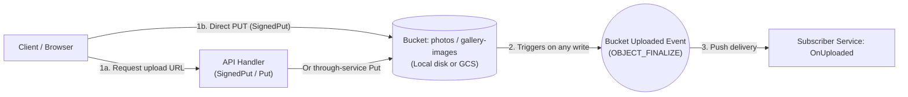

# `tako.Bucket` — blobs, signed URLs, upload events

A bucket is an object store: keys to blobs, streamed both ways, with
an event source that makes uploads the start of a pipeline.

## Declare

**Go**
```go
var photos = tako.Bucket("photos")

var OnUploaded = tako.Subscribe(photos.Uploaded, onUploaded)
```

**cfire**
```cfire
Images := tako.bucket("gallery-images")
```



The name must be a string constant (analyzer-enforced). `Uploaded` is
the bucket's event source — bind handlers with `tako.Subscribe`; the
payload type is `tako.ObjectInfo` (key, size, content type, updated).

## Use

Keyed like every keyed store — `Get`, `Put`, `Delete`, `Exists` — plus
`List(ctx, prefix)`, which iterates `ObjectInfo` in key order.
`tako.Blob` is the streaming currency: a reader plus content type and
size. A handler returning `tako.Blob` streams the object with the
right `Content-Type`; a `tako.Blob` request field makes the request
multipart:

**Go**
```go
type UploadReq struct {
    Caption string    `form:"caption"`
    Img     tako.Blob `form:"img"`
}

func serveImage(ctx tako.Ctx, req ImageReq) (tako.Blob, error) {
    return photos.Get(ctx, req.ID) // miss → IsNotFound → 404
}
```

**cfire**
```cfire
download_photo(ctx: tako.Ctx, req: PhotoPathReq) -> tako.Blob! {
    obj := try Images.get(ctx, req.id)
    return Ok(obj)
}
```

### The headers a blob answers with

`Content-Type` from the blob, `Content-Length` when the size is known,
`ETag` when the blob carries one (see below), and
`X-Content-Type-Options: nosniff` always — a blob is the one
response whose bytes came from outside the program, so the declared
type is a claim about someone else's data and the browser must not go
looking past it.

Caching is opt-in per route, the same `MaxAge` a page declares. Without
it a blob answers `no-cache`:

```go
// Derived from bytes that never change, and requested once per photo
// per scroll — so it says how long a shared cache may keep it.
var Thumb = tako.API("GET /api/photos/{id}/thumb", thumb,
    tako.Route{MaxAge: 24 * time.Hour})
```

Pair a long `MaxAge` with a URL that changes when the bytes do. If a
stored object is ever replaced **in place** under a URL that stays the
same, leave `MaxAge` off: the failure is a stale image under a
published page, with no error anywhere to notice.

**That case is what `Blob.ETag` is for.** A lifetime says "do not ask
again for a day"; a validator says "ask, cheaply". `bucket.Get` fills the
field in from the stored object, so a handler that streams what was
uploaded revalidates without writing a line:

```go
func serveMedia(ctx tako.Ctx, req MediaReq) (tako.Blob, error) {
    return media.Get(ctx, req.Key)   // the ETag rides along
}
```

Tako sends it and answers `304 Not Modified` when the request's
`If-None-Match` matches — no body, and the reader closed. A replaced
object has different bytes, so it has a different ETag, so the reader
gets the new one: none of `MaxAge`'s risk, and `no-cache` starts meaning
"ask first" instead of "download it all again".

Set `ETag` yourself for bytes you build — a resize, a rendered
document — and make it change whenever the bytes do. That contract is
the one thing tako cannot check for you. A blob with no ETag behaves
exactly as before: no header, no 304.

What this does not save is the fetch from the bucket into your service:
the handler still runs. The hop it saves is the one that costs — your
service to a phone on a mobile network.

For large files, skip the service entirely: `SignedPut` returns a URL
the browser PUTs to directly — no 32MB request cap, no proxying —
constrained by `PutPolicy.MaxSize` and `PutPolicy.ContentType` (trailing wildcard
allowed), enforced when the client uploads, not when the URL is
minted. `SignedGet` shapes downloads the same way.

A `PutPolicy.MaxSize` URL signs a size-range condition into the request, so
the PUT **must carry the matching header** — `PutPolicy.Headers`
builds it from the same options, and both backends refuse a PUT
without it (local says so with a pointer; GCS fails the signature):

```go
var uploadLimits = tako.PutPolicy{ContentType: "image/*", MaxSize: 20 << 20}

url, err := photos.SignedPut(ctx, p.ID, 15*time.Minute, uploadLimits...)
ticket := UploadTicket{UploadURL: url, UploadHeaders: uploadLimits.Headers()}
```

**Every successful write fires `Uploaded`** — through-service `Put` or
signed direct upload; the pipeline doesn't know or care how bytes
arrived. That includes your own handlers' writes: gallery's subscriber
filters out its `_thumb` outputs, the standing idiom.

## Local

`tako dev` stores objects on disk under the data dir. Signed URLs
point back at the service's own `/_tako/api/signed/` endpoint, enforcing
the same constraints with the same error texts as the cloud path.
Uploads fire `Uploaded` through the in-process dispatcher, so the
whole pipeline — event, queue, worker, fan-out — narrates on the dev
console.

## Cloud

Each bucket becomes a GCS bucket named
`<project>-<app>-<env>-<name>`, uniform access, with **CORS
configured for signed transfers** — browsers execute signed URLs
directly against the bucket, which is `SignedPut`'s whole point. A
bucket with `Uploaded` subscribers also gets an events topic fed by
GCS's own `OBJECT_FINALIZE` notifications: every write — signed or
through-service — lands there without the runtime's involvement, and
each subscriber's private service consumes it with the standard
redelivery policy ([topic.md](topic.md)). Grants are derived: a
service that touches the bucket gets exactly that access, traced in
the deploy summary. You pay GCS storage and operations; the bucket
itself is not compute.

## Test it

`tako.NewTestApp` gives each test a fresh on-disk bucket, events
included — gallery's suite uploads a real PNG, drains the queues, and
asserts the thumb exists and decodes
([examples/gallery/app_test.go](../../examples/gallery/app_test.go)).
The signed-URL contract — 415/413 texts, the lying-stream cap — is
pinned over real HTTP in
[examples/gallery/http_test.go](../../examples/gallery/http_test.go).

## Errors you'll meet

- `tako.Bucket name must be a string constant — names are read at analysis time, not run time; got variable "name" (tako/const-name)`
- Signed upload rejections, at upload time, with honest texts:
  `{"error":"content type \"text/plain\" does not match required \"image/*\""}` (415),
  `{"error":"upload is 20 bytes; the signed URL allows at most 16"}` (413), and — for chunked
  uploads that hide their length — `{"error":"upload exceeds the signed URL's 16-byte limit"}` (413),
  leaving no object behind.
- `tako: no bucket backend wired — run via tako dev, a generated service, or tako.NewTestApp; a tool that reaches a deployed app calls runtime.BootGCPWith first` — a panic in bare tests without a
  booted app.

## Not yet

- `Uploaded` is the only event — no delete or archive events.
- No bucket-level declaration options (lifecycle rules, versioning,
  public buckets); `Delete` of a whole bucket never happens
  automatically — data destruction is never automatic.
- `SignedGet` takes no constraint options; constraints are an upload
  concern.
