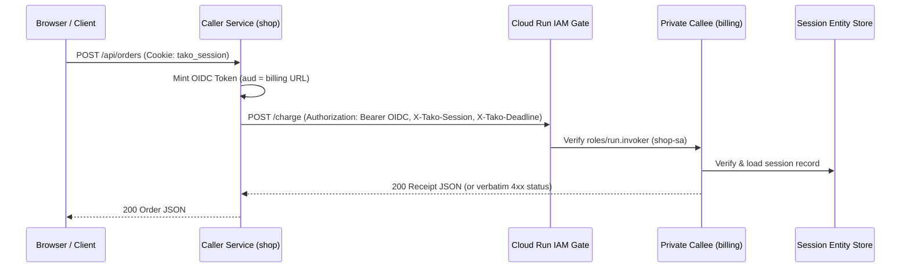

# calls.md — cross-service calls

Package = service (§2.12). `mkdir` makes a service, not YAML: the
analyzer partitions the package tree, and an **exported `Endpoint`
var** in another package is the RPC surface — typed, visible at the
call site, no client code to maintain. Events (Topic/Queue) are the
preferred inter-service style; sync calls exist for the hops that must
be sync, and their costs are surfaced, never hidden.

## Declare

From [examples/shop/billing](../../examples/shop/billing/billing.go):

```go
// Charge is the RPC surface: an EXPORTED Endpoint var, callable from
// other service packages as billing.Charge.Call(ctx, req) — typed,
// visible at the call site, no client code to maintain. Route.Private
// closes the front door: only granted service identities invoke
// (browsers and curl get 403 from Cloud Run itself).
var Charge = tako.API("POST /charge", charge, tako.Route{Private: true})
```

`Route.Private` is IAM-only ingress, **not** network-internal — a settled
decision; VPC anything is a later explicit opt-in. Private and public
routes cannot share a package (Cloud Run enforces ingress per service).

## Use

```go
receipt, err := billing.Charge.Call(ctx, billing.ChargeReq{OrderID: o.ID, AmountCents: o.TotalCents})
```

The hop is deliberately visible at the call site. Typed errors cross
verbatim: billing's `tako.Errorf(422, "amount must be positive")` is
`placeOrder`'s 422 to handle, never a mystery 500. Calls never silently
retry. Call cycles are impossible by construction — calling a service
means importing its package, and Go forbids import cycles.

The caller's session propagates AUTOMATICALLY: the `X-Tako-Session`
header carries the session id, and the callee resolves it against the
shared session store — presenting the id is equivalent to presenting
the cookie, the record lookup IS the verification, and revocation kills
the identity mid-chain. Billing sees the same verified user; a worker's
anonymity stays honest.

## Local

In dev, tests, and co-located packages `.Call` is a direct in-process
function call — a breakpoint in `placeOrder` steps straight into
`charge`. Remote transports are wired only for genuinely remote
callees, so nothing changes shape locally.

## Cloud



One authenticated HTTP round trip over the endpoint's own route. The
caller mints an OIDC identity token from the metadata server for the
callee's URL (its own service account's identity, cached ~50 minutes;
Cloud Run validates it at the front door), and three headers ride
along: `X-Tako-Session` (identity), `X-Tako-Deadline` (an absolute
deadline the callee honors), `X-Tako-Request` (trace id, so `tako logs`
correlates a chain). Deadline budgets: the caller propagates its
remaining deadline minus a 500ms margin; below the 1s floor the call
fails before the network does.

IAM is derived, never hand-written: every call edge grants the caller's
service account `roles/run.invoker` on the callee, and the deploy
summary shows it — billing reads `ingress: IAM-only (callers: shop-sa)`.
Deploy prices sync hops honestly (`warnCallEdges` in cmd/tako/deploy.go):

```
⚠ sync call shop → billing lands on a scale-to-zero service — cold starts bill the caller's latency; give billing tako.Service(tako.ServiceConfig{Profile: tako.ProfileLatency}) (min-instance cost) or make the interaction async
⚠ sync call chain a → b → c — waiting callers hold their own request slots and couple the services' autoscaling; prefer events past one hop
```

## Test it

Call across in-process and assert the typed error and the propagated
user — [billing_test.go](../../examples/shop/billing_test.go):

```go
_, err := billing.Charge.Call(ctx, billing.ChargeReq{OrderID: "o1", AmountCents: 0})
he, ok := err.(interface{ HTTPStatus() int })
if !ok || he.HTTPStatus() != 422 || !strings.Contains(err.Error(), "amount must be positive") {
	t.Fatalf("err = %v — billing's 422 must be the caller's 422", err)
}
```

## Errors you'll meet

- Calling the handler function instead of the var:
  `ChargeFn is a handler function — cross-service calls go through the
  Endpoint var (billing.Charge.Call(ctx, req)) so the RPC boundary
  stays visible (tako/raw-call)`
- `service mixedingress mixes private and public routes — Cloud Run
  enforces Route.Private at the service level, so private endpoints need
  their own package (tako/mixed-ingress)`
- A 401/403 at the callee's front door: `this service cannot invoke
  billing — the derived grant run.invoker is missing or still
  propagating; re-run tako deploy, and file it if it persists`
- `billing answered 404 — its URL may have changed; re-run tako deploy`
- `deadline budget exhausted before calling billing (312ms remaining
  after the 500ms margin)`

## Not yet

- Calls are unary JSON — no streaming.
- No automatic retries, ever; retry semantics belong to
  [queues](queue.md).
- IAM-only is the whole privacy story; network-internal (VPC) ingress
  is a later explicit opt-in.
