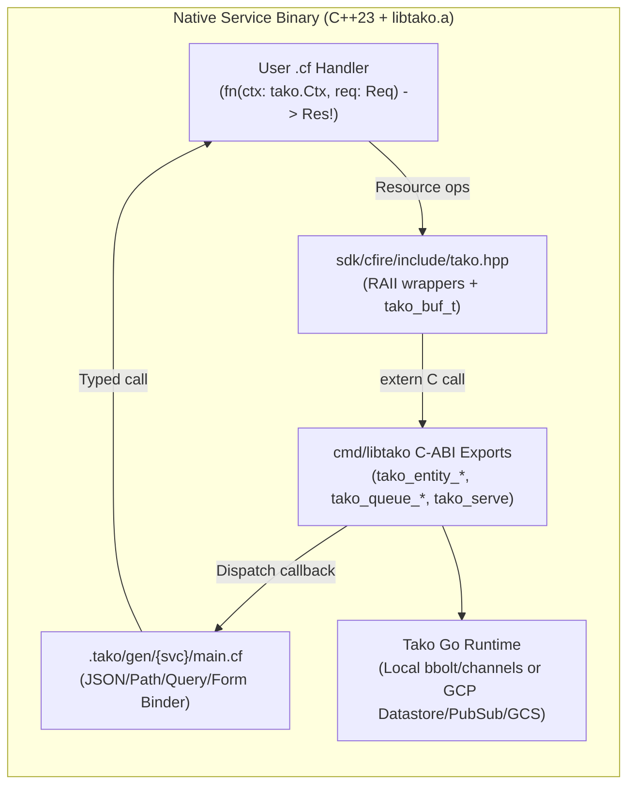

# cfire (`core:tako`) — native C++23 systems SDK

Tako supports writing services in **[cfire](https://cfire.memo.engineer)** (`.cf`), compiling [1-to-1 ISO C++23](https://cfire.memo.engineer/guide.html#chapter-1)
business logic ([Systems Landscape](https://cfire.memo.engineer/#landscape) · [Performance & Comparison Matrix](https://cfire.memo.engineer/#benchmarks) · [Stdlib Catalog](https://cfire.memo.engineer/reference.html) · [GitHub](https://github.com/gsandoval/cfire)) into a single binary linked against Tako's Go runtime
and cloud backends via a static C-archive bridge (`libtako.a`).

## Declare

Import `"core:tako"` and declare resources and handlers as top-level
package bindings (from [examples/cfire-shortlink](../../examples/cfire-shortlink/shortlink.cf)
and [examples/cfire-gallery](../../examples/cfire-gallery/gallery.cf)):

```cfire
package shortlink

import "core:tako"

Links   := tako.entity[Link]("links")
Clicks  := tako.queue[ClickEvent]("clicks")
HotUrls := tako.cache[str]("hot-urls")
Assets  := tako.bucket("assets")
Uploads := tako.counter("uploads_total")

CreateLink   := tako.api("POST /links", create_link)
GetLink      := tako.api("GET /links/{code}", get_link)
ProcessClick := tako.worker("Clicks", process_click)
PruneExpired := tako.cron("0 * * * *", prune_expired)
```

Supported constructors mirror the Go SDK:
- **Stateful & observability resources:** `tako.entity[T](name)`, `tako.bucket(name)`, `tako.queue[T](name)`, `tako.topic[T](name)`, `tako.job[T](name)`, `tako.cache[T](name)`, `tako.lock(name)`, `tako.secret(name)`, `tako.counter(name)`, `tako.histogram(name)`, `tako.site(dir)`, `tako.auth()`, `tako.role(name)`.
- **Handlers:** `tako.api(route, fn)`, `tako.page(route, fn)`, `tako.worker(queue_var, fn)`, `tako.subscribe(topic_var, fn)`, `tako.cron(schedule, fn)`, `tako.runner(job_var, fn)`, `tako.singleton(fn)`.



## Use

Handlers take `ctx: tako.Ctx` as their first parameter and return a
[fallible result `Res!`](https://cfire.memo.engineer/guide.html#chapter-6) (or `void!` / `bool!` for async workers and cron jobs), using [compile-time struct tags](https://cfire.memo.engineer/guide.html#chapter-5) for request binding and entity indexing:

```cfire
fn create_link(ctx: tako.Ctx, req: CreateLinkReq) -> Link! {
    if req.url == "" {
        return Err(tako.bad_request("url is required"))
    }
    link := Link{
        code:       "cfire1",
        url:        req.url,
        owner_id:   "anon",
        clicks:     0,
        created_at: ctx.now_unix(),
    }
    try Links.put(ctx, link)
    try HotUrls.set(ctx, link.code, link.url, 3600)
    try Clicks.publish(ctx, ClickEvent{code: link.code, ts_unix: link.created_at})
    return link
}

fn get_link(ctx: tako.Ctx, req: GetLinkReq) -> Link! {
    if cached := HotUrls.get(ctx, req.code); cached.has_value() {
        return Link{code: req.code, url: cached.value()}
    }
    opt := try Links.get(ctx, req.code)
    if !opt.has_value() {
        return Err(tako.not_found("link not found"))
    }
    return opt.value()
}
```

### Handle operations

- **Entity (`tako.entity[T]`):** `.get(ctx, id) -> T?!`, `.put(ctx, val) -> void!`, `.remove(ctx, id) -> void!`, `.query() -> Query[T]` (`.where(field, op, val)`, `.order_by(field)`, `.limit(n)`, `.all(ctx) -> []T!`), `.tx(ctx, |tx| -> void!)`.
- **Bucket (`tako.bucket`):** `.put(ctx, key, data, content_type) -> void!`, `.get(ctx, key) -> bytes!`, `.remove(ctx, key) -> void!`, `.signed_url(ctx, key, method, ttl_sec) -> str!`.
- **Queue & Topic (`tako.queue[T]`, `tako.topic[T]`):** `.publish(ctx, msg) -> void!`.
- **Cache (`tako.cache[T]`):** `.get(ctx, key) -> T?`, `.set(ctx, key, val, ttl_sec) -> void!`, `.remove(ctx, key) -> void!`.
- **Lock (`tako.lock`):** `.with_lease(ctx, ttl_sec, || -> void!) -> void!`.
- **Secret (`tako.secret`):** `.get(ctx) -> str!`.
- **Metrics (`tako.counter`, `tako.histogram`):** `.inc(delta)`, `.observe(value)`.

## Local

When a directory contains `.cf` files and no `go.mod`, Tako switches
automatically to its cfire pipeline:
1. **Analysis:** `pkg/analyzer` invokes `cfire outline --json` to extract structs, field tags, global declarations, and functions into `AppGraph`.
2. **Codegen:** `pkg/codegen` writes `.tako/gen/<service>/main.cf` and `.tako/gen/<service>/harness/tako_harness.cf`.
3. **Runtime Bridge:** `pkg/build.EnsureLibTako` compiles [cmd/libtako/main.go](../../cmd/libtako/main.go) via `go build -buildmode=c-archive` into `.tako/lib/libtako-<goos>-<goarch>.a` and passes `--link-lib` and `--include` ([sdk/cfire/include](../../sdk/cfire/include/tako.hpp)) to `cfire build`.

Memory across the C-ABI boundary is managed deterministically through
`tako_buf_t` value buffers and `tako_c_free` RAII wrappers in
`tako.hpp`.

## Cloud

`tako build` and `tako deploy` cross-compile each generated cfire
service with `cfire build --target=x86_64-linux-gnu` linked against
`libtako-linux-amd64.a`. Because C++23 binaries and cgo archives link
dynamically against `glibc`, `libpthread`, and `libstdc++`, cfire
services layer onto `gcr.io/distroless/cc-debian12:nonroot` instead of
`static-debian12:nonroot`. Image layers are stamped with deterministic
epoch timestamps (`time.Unix(0, 0)`), and Cloud Run, Datastore indexes,
Pub/Sub subscriptions, and least-privilege IAM reconcile identically to
Go services.

## Test it

`tako test` discovers `*_test.cf` files in the module directory and
invokes `cfire test <file> --link-lib <libtako.a> --include <sdk_dir>`,
giving tests full in-process access to `tako.TestApp` (HTTP request
injection, `drain()` for async queues, and isolated per-test local
state).

## Errors you'll meet

The cfire analyzer enforces the same core structural rules and rule IDs
as the Go analyzer (see [errors.md](errors.md)):

- **`tako/const-name`** — A resource name or route pattern passed to a
  `tako.*` constructor is empty or not a string literal (see
  [entity.md](entity.md)).
- **`tako/entity-id`** — An entity struct has no field tagged
  `entity:"id"`, multiple fields tagged `entity:"id"`, or an ID field
  whose type is not `str` (see [entity.md](entity.md)).
- **`tako/route-params`** — A `{param}` placeholder in an API/Page
  route pattern has no matching `path:"param"` field on the request
  struct, or a `path:"param"` struct field does not appear in the route
  pattern (see [api.md](api.md)).

## Not yet

- Server-rendered HTML templates (`tako.Page` with `templates/*.html`
  and automatic CSRF form injection) and sanitized markdown rendering
  remain Go-first; cfire services focus on JSON APIs, storage, queues,
  caches, and background workers.
- Cross-service typed RPC stub generation (`Endpoint.Call` across
  separate packages) is currently Go-only.
