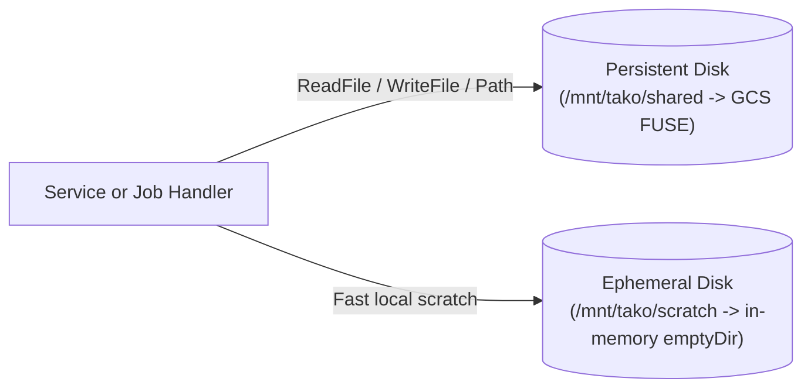

# `tako.Disk` — mounted filesystems for services and jobs

A disk is a real POSIX directory tree mounted into every Cloud Run service or
job whose handlers touch it — either a persistent shared disk backed by Cloud
Storage FUSE, or a fast in-memory scratch volume (`emptyDir`) scoped to each
container instance.

Reach for `tako.Bucket` when you are storing and serving objects by key. Reach
for `tako.Disk` when a library, model loader, or subprocess (`ffmpeg`,
`sqlite3`, `tar`) needs a filesystem path.

## Declare

**Go**
```go
var Shared = tako.Disk("shared")

var Weights = tako.Disk("weights", tako.DiskConfig{
    ReadOnly: true,
})

var Scratch = tako.Disk("scratch", tako.DiskConfig{
    Ephemeral: true,
    SizeLimit: "1Gi",
})
```

**cfire**
```cfire
Shared := tako.disk("shared")
Weights := tako.disk("weights")
Scratch := tako.disk("scratch")
```



The name must be a lowercase physical resource name (`a-z`, `0-9`, `-`).
`tako.DiskConfig` carries three optional settings:

- `DiskConfig.ReadOnly` — mounts the volume read-only at the container level and
  makes any write call on the handle (`WriteFile`, `Create`, `OpenFile`,
  `Remove`, `MkdirAll`) an analysis error before deploy.
- `DiskConfig.Ephemeral` — provisions a per-instance in-memory `emptyDir`
  volume instead of a persistent Cloud Storage bucket.
- `DiskConfig.SizeLimit` — caps the capacity of an `Ephemeral` disk (for
  example, `"512Mi"` or `"2Gi"`, up to `"32Gi"`). Setting `SizeLimit` without
  `Ephemeral: true` is refused at analysis time.

## Use

Every method on `tako.DiskHandle` takes a `context.Context` (`tako.Ctx`
satisfies it) so the static analyzer can trace which services and jobs touch
the disk, and so `tako.NewTestApp` can isolate disk roots per test:

**Go**
```go
func transcode(ctx tako.Ctx, req VideoReq) (VideoRes, error) {
    weights, err := Weights.ReadFile(ctx, "encoder.bin")
    if err != nil {
        return VideoRes{}, err
    }
    if err := Scratch.WriteFile(ctx, "work/input.bin", weights, 0o644); err != nil {
        return VideoRes{}, err
    }
    workPath := Scratch.Path(ctx, "work/input.bin")
    if err := Shared.MkdirAll(ctx, "exports", 0o755); err != nil {
        return VideoRes{}, err
    }
    return VideoRes{Path: workPath}, nil
}
```

**cfire**
```cfire
fn transcode(ctx: tako.Ctx, req: VideoReq) -> VideoRes! {
    weights := try Weights.read_file(ctx, "encoder.bin")
    try Scratch.write_file(ctx, "work/input.bin", weights)
    work_path := Scratch.path(ctx, "work/input.bin")
    return VideoRes{path: work_path}
}
```

The handle provides standard file operations:

- `ReadFile(ctx, name)` and `WriteFile(ctx, name, data, perm)`
- `Open(ctx, name)`, `Create(ctx, name)`, and `OpenFile(ctx, name, flag, perm)`
- `Stat(ctx, name)`, `Remove(ctx, name)`, and `MkdirAll(ctx, path, perm)`
- `Path(ctx, rel)` — returns the resolved host path inside the mount so you can
  hand it to `exec.Command` or standard library helpers
- `FS(ctx)` — returns an `fs.FS` rooted at the disk

All relative paths are cleaned and checked against the disk root; any `".."`
traversal or absolute path is rejected before touching the filesystem.

## Local

During `tako dev`, persistent disks live under `.tako/data/disks/<name>/` and
ephemeral disks live under `.tako/data/disks-ephemeral/<name>/`. Your handlers
use the exact same `DiskHandle` methods locally and in the cloud.

## Cloud

`tako deploy` inspects the usage graph and attaches Cloud Run v2 `volumes` and
`volumeMounts` (`/mnt/tako/<name>`) only to the services and jobs whose
handlers reference the disk:

- **Persistent disks** (`Ephemeral: false`, the default) provision a dedicated
  Cloud Storage bucket (`<project>-<app>-disk-<env>-<name>`) with uniform
  bucket-level access and mount it via Cloud Storage FUSE. Services and jobs
  with read-only edges (`ReadFile`, `Open`, `Stat`, `FS`, `Path`) receive
  `roles/storage.objectViewer`; services and jobs with write edges
  (`WriteFile`, `Create`, `OpenFile`, `Remove`, `MkdirAll`) receive
  `roles/storage.objectAdmin`.
- **Ephemeral disks** (`Ephemeral: true`) attach a Cloud Run `emptyDir` volume
  with `medium: MEMORY` and your `SizeLimit` (default `"512Mi"`), creating no
  bucket and no IAM bindings.

## Test it

Each `tako.NewTestApp` instance creates its own temporary directory, so disk
writes in one test never leak into parallel tests:

**Go**
```go
func TestScratchDisk(t *testing.T) {
    app := tako.NewTestApp(t)
    ctx := app.Ctx()

    if err := Scratch.WriteFile(ctx, "job/out.txt", []byte("ready"), 0o644); err != nil {
        t.Fatal(err)
    }
    got, err := Scratch.ReadFile(ctx, "job/out.txt")
    if err != nil || string(got) != "ready" {
        t.Fatalf("got %q, err %v", string(got), err)
    }
}
```

**cfire**
```cfire
test "scratch disk round-trip" {
    app := tako.new_test_app()
    defer app.close()
}
```
