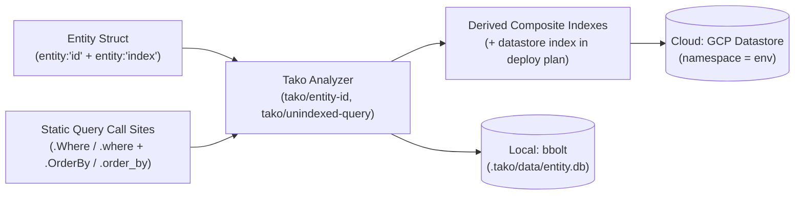

# tako.Entity — typed entity stores

`tako.Entity[T]` is *an* entity store — deliberately not "the
database". No global DB, Tx, or Query: transactions and queries are
methods on the store you declared. Datastore in the cloud, bbolt locally.

## Declare

From [examples/shortlink](../../examples/shortlink/app.go) (Go) and [examples/cfire-shortlink](../../examples/cfire-shortlink/shortlink.cf) (`cfire`):

**Go**
```go
var links = tako.Entity[Link]("links")

type Link struct {
    Slug    string    `entity:"id" json:"slug"`
    URL     string    `json:"url"`
    Owner   string    `entity:"index" json:"owner"`
    Created time.Time `entity:"index" json:"created"`
    Hits    int       `json:"hits"`
}
```

**cfire**
```cfire
Links := tako.entity[Link]("links")

type Link struct {
    code:       str `entity:"id" json:"code"`
    url:        str `json:"url"`
    owner_id:   str `entity:"index" json:"owner_id"`
    clicks:     i64 `entity:"index" json:"clicks"`
    created_at: i64 `entity:"index" json:"created_at"`
}
```



The struct is the schema: `entity:"id"` marks the key field (exactly
one, a string), `entity:"index"` the fields you may filter and order
by. The name is the store's stable identity — a string constant.

**Untagged fields are stored and never indexed**, which is what lets
them be large. A `Body string` holding 40 KB of markdown is fine; a
field carrying `entity:"index"` is subject to the store's cap on an
indexed value (1500 bytes in Datastore) and is refused past it, on
both backends, with the tag named:

```
tako: entity "posts": Title is declared entity:"index" and this value is
      1842 bytes — an indexed string is capped at 1500. Drop the tag if you
      do not query on Title; keep it and put the long text in another
      field, which is not indexed and has no such limit.
```

`local` enforces that cap too, though it indexes nothing and does not
need to: a limit you only meet on the first deploy is not a limit the
conformance suite did its job on.

## Use

Keyed access like every keyed store: `Get`, `Put`, `Delete`, `Exists`.
`Put` stores under the id carried by the `entity:"id"` field; absence
reports through `tako.IsNotFound`; deleting an absent id is not an
error. `Update` is a transactional read-modify-write:
`links.Update(ctx, slug, func(l *Link) { l.Hits++ })`.

Queries build on the store and touch only indexed fields —
`q.Where("Owner", "=", owner).OrderBy("-Created").Limit(100).All()`.
`Where` takes one of `=` `<` `<=` `>` `>=`; `OrderBy` is `-`-prefixed
for descending; `All`, `First`, `Iter`, or `Count` execute.

`Count` returns how many entities match, and **ignores `Limit`**:

```go
list, err := posts.Query(ctx).Where("Published", "=", true).
	OrderBy("-Created").Limit(50).All()
total, err := posts.Query(ctx).Where("Published", "=", true).Count()
// "Showing 50 of 214"
```

That is the decision, not an oversight. `Limit` shapes a page; the total
is not a property of the page, and `Limit(50).Count()` returning 50
would answer a question nobody asked. Ordering is ignored too — it
cannot change how many things match.

On `gcp` this is a Datastore aggregation, billed per index entry scanned
rather than per entity returned, so counting a large match does not read
it. On `local` it walks the same filter the scan uses. The conformance
suite holds the two to the same answers, filters included.

### Paging

`Page(cursor)` returns one page and where to resume. The empty string
starts at the beginning; an empty returned cursor is the last page:

```go
page, err := photos.Query(ctx).Where("Ready", "=", true).
	OrderBy("-Created").Limit(20).Page(req.Cursor)

return PhotoPage{Photos: page.Items, Cursor: page.Cursor}, nil
```

**`OrderBy` and `Limit` are both required**, and `Page` refuses without
them:

```
tako: Page needs an explicit OrderBy — a cursor names a position in an order,
and there is no stable position without one; add OrderBy on whichever field you
mean to page through
```

That refusal is the interesting part of the feature. A cursor names a
position in an order, and the `gcp` backend cannot always push tako's
default id order down beside an inequality filter — it sorts
client-side, and the server cursor it holds is then a position in a
*different* order than you asked for. Handed back, it would silently
skip or repeat rows. Rather than page correctly on `local` and lie in
the cloud, both backends refuse the same way.

The cursor is **keyset**, not an offset: it names the last row seen, so
a row written before that position does not shift the next page and no
row is served twice. The conformance suite pins that with a
write-between-pages case — one row inserted before the cursor, one
after, one deleted — that both backends must observe identically.

The cursor is opaque and belongs to the query that produced it. Changing
the filters or the order between pages is a different walk, not a
continuation of this one.

**A cached first page must cache the cursor with it.** A cursor cannot
be rebuilt from the rows it points past, so caching only the items
leaves a page that can never say what comes after it — gallery caches
the whole `PhotoPage`.

`Tx` / `tx` runs a multi-entity transaction scoped to this store; an error
rolls back and returns unchanged, so `tako.Errorf` statuses compose —
shortlink claims or updates a slug atomically:

**Go**
```go
err := links.Tx(ctx, func(tx tako.EntityTx[Link]) error {
    if _, err := tx.Get(req.Slug); err == nil {
        return tako.Errorf(409, "slug %q is taken", req.Slug)
    } else if !tako.IsNotFound(err) {
        return err
    }
    return tx.Put(link)
})
```

**cfire**
```cfire
try Links.tx(ctx, |tx| -> bool! {
    cur := try tx.get(evt.code)
    updated := Link{code: cur.code, url: cur.url, owner_id: cur.owner_id, clicks: cur.clicks + 1, created_at: cur.created_at}
    try tx.put(evt.code, updated)
    return Ok(true)
})
```

## Local

`tako dev` runs entities on a single bbolt file —
`.tako/data/entity.db` — in-process; no Datastore emulator, no Docker.
Data persists across dev reloads, and the shared conformance suite is
the contract that `local` and `gcp` behave alike.

## Cloud

The same declaration becomes Datastore — envs isolated by namespace
(namespace = env), kinds keeping their plain names. The document is
stored whole in one excluded blob; each scalar field is mirrored as a
property so queries have something to match, and **only the fields you
tagged are indexed** — the rest go up `excludeFromIndexes`, present and
readable and under no size cap.

Indexes are **derived from your call sites**, never hand-declared:
single-property
indexes from the fields you actually `Where`/`OrderBy`, and a Datastore
**composite index per combined query shape**, grouped per function —
filter fields first (struct order, ascending), then `OrderBy` fields in
call order, `-`-prefixed for descending, in marshaled JSON property
names. The one query in [examples/blog](../../examples/blog/app.go) —
`.Where("Post", "=", …).OrderBy("Created")` — derives
`comments (post, created)`; shortlink's derives `links (owner, -created)`.

**A query built across a branch is more than one shape**, and each gets
its own index:

```go
q := photos.Query(ctx).Where("Ready", "=", true)
if owner != "" {
	q = q.Where("Owner", "=", owner)
}
```

runs as `{ready}` for an anonymous caller and `{ready, owner}` for a
signed-in one — so tako derives `photos (ready, -created)` **and**
`photos (owner, ready, -created)`. Datastore will not serve the first
query from the second index: a composite is only usable by a query that
constrains its leading properties. Filters in mutually exclusive arms
(`if`/`else`) are treated as independently optional, so the combination
that cannot occur is derived too — over-indexing is the safe direction.

**A query built across FUNCTIONS is still one query.** A function that
takes or returns an `*EntityQuery[T]` is a fragment of somebody's
query, not a query of its own:

```go
func published(q *tako.EntityQuery[Post]) *tako.EntityQuery[Post] {
	return q.Where("Published", "=", true)
}

list, err := published(posts.Query(ctx)).OrderBy("-Created").Limit(50).All()
```

The fragment's filter is folded into each caller at the position it is
called and under that call site's branches — call it inside an `if` and
everything it carries becomes optional there. Fragments compose, and an
uncalled one derives nothing, because a shape that never runs does not
need an index.

What tako **cannot** follow it refuses (`tako/query-escapes`): a query
stored in a struct field, sent on a channel, or passed to a function
value has no traceable path to the code that runs it. Guessing low
there is a 500 in production that nothing local would show.

Past **four** conditional filters in one function the powerset stops
being reasonable — sixteen indexes for one query — and tako refuses at
analysis time (`tako/query-shapes`) rather than deriving a set that
would not fit Datastore's 200-per-project limit. Split the query.

Composite indexes are built at deploy time and are the slowest part of a
first deploy: **~4 minutes each**, flat, regardless of how much data you
have. tako starts every build at once (Datastore builds them
concurrently) and collects them just before your services go live, so
the wait overlaps the image push rather than adding to it. Two indexes
cost ~4 minutes, not ~8.

`tako deploy` shows each composite as a `+ datastore index` plan entry,
annotated with the query that asks for it, and creates it before the
services, waiting on the build (first builds take minutes):

```
+ create  datastore index photos (ready, -created)         ← app.go:404 readyPage
+ create  datastore index photos (owner, ready, -created)  ← app.go:404 readyPage
```

An entry with no arrow is an index nothing declares. Live indexes on kinds tako manages that match no current
query shape are orphans — schema churn's leftovers — shown as
`? orphaned (kept)` and deleted by `tako prune` with no ceremony:
indexes are derivable, never data. Entity data only ever goes behind
`tako prune --data`'s typed confirmation; foreign kinds are invisible to both.

## Test it

`tako.NewTestApp` boots fresh in-process backends per test — two apps
share nothing. From [examples/shortlink](../../examples/shortlink/app_test.go):

```go
app := tako.NewTestApp(t)
ctx := app.Ctx()
_, err := Create.Call(ctx, CreateReq{Slug: "gh", URL: "https://github.com"})
```

Assert against the store directly (`links.Get(ctx, "gh")`) — absence
via `tako.IsNotFound`, statuses via `err.(interface{ HTTPStatus() int })`.

## Errors you'll meet

At analysis time, verbatim:

```
app.go:7:6: entity type Link must have exactly one field tagged entity:"id" (tako/entity-id)
app.go:8:2: entity id field Slug must be a string; got int (tako/entity-id)
app.go:7:31: tako.Entity name must be a string constant — names are read at analysis time, not run time; got variable "n" (tako/const-name)
app.go:17:32: query field must be a string constant — indexes are derived at analysis time; got variable "f" (tako/const-query-field)
app.go:18:9: query filters on Link.URL, but URL is not indexed — tag it entity:"index" to make it queryable (tako/unindexed-query)
app.go:15:2: field Secret is tagged entity:"index" but json:"-" keeps it out of the stored document — an index on a field nothing writes matches nothing, silently; drop one of the two tags (tako/entity-index)
```

In Datastore, a composite index property follows the MARSHALED name
(`json:"owner_id"` is stored and indexed in Datastore as `owner_id`),
while `.Where("Owner", ...)` and `.OrderBy("-Owner")` in Go always take
the **Go struct field name** `Owner` — the analyzer and runtime map the
struct field name to its marshaled property name automatically.
`json:"-"` is the one spelling that removes the field from the
document, and indexing it is refused above; `json:"-,"` is not that
spelling — it names the property `-`, and is indexed under that name.

At run time: `Put` with an empty id fails with `tako: entity "links":
id field Slug is empty`; outside a wired app, calls panic with
`tako: no entity backend wired — run via tako dev, a generated service, or tako.NewTestApp; a tool that reaches a deployed app calls runtime.BootGCPWith first`.

## Not yet

- Query ops stop at `=`, `<`, `<=`, `>`, `>=` — no `!=`, `IN`, or
  full-text. `All`/`First`/`Iter` materialize, so bound them with
  `Limit`; to walk a large match, page it with [`Page`](#paging).
- Ids are strings, never auto-generated — mint with `tako.NewID()`.
- Transactions are per-store; cross-resource sections are
  [tako.Lock](lock.md)'s job.
- No migrations: entities are JSON documents; renamed fields are your
  data to move.
